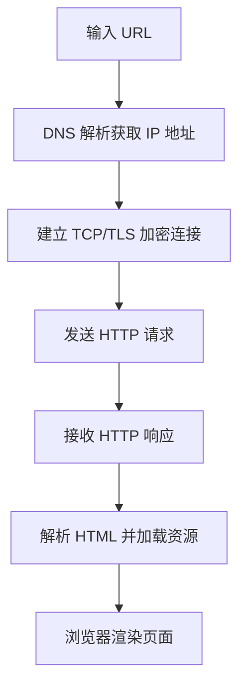

<p align="center"></p>

# magpie-translator

**One model does the work; a second model you choose retells its final reply the way your prompt asks: plain language, another tone, another language, more structure, even a diagram. The original goes back to the session unchanged, and the retelling never enters it.**

[中文说明](README.md) · [Design notes](docs/DESIGN.md) · MIT

## What it is

A [magpie](https://github.com/yetone/magpie) plugin that adds a general **rewrite layer**, not just a translator:

- The work model (e.g. GPT behind Codex) answers as usual; the agent receives the original and the session history is untouched.
- When the turn ends, the plugin sends the final reply to a second model with your **prompt**.
- The result lands on magpie's Translations page (and optionally log, file, notify, webhook). It is never written back into the session, and the next request doesn't contain it.
- Code blocks, inline code and `$ ` commands are masked before the rewrite and restored as-is.

Translation is one use case. Change the prompt to get plain language, a different tone, a structured summary, or a mermaid diagram. About images: the plugin stores whatever the second model writes. A model can emit a mermaid block or Markdown image links, but whether they render depends on where you view them (GitHub renders mermaid). The plugin does not generate images itself.

## Prompt settings (as implemented)

- **Global `prompt`** replaces the default task sentence. Placeholders: `{language}`, `{style}`, `{model}` (work model), `{translator}` (rewrite model). Empty means the default: rewrite into plain, easy-to-read `{language}` without adding or dropping information.
- **`style`** is appended after the prompt. The panel has four presets (plain words, keep terms, brief, full) or free text.
- **Per-rule overrides**: each rule can set its own `language`, `prompt`, `style`, `display`, `webhookUrl`.
- Always kept regardless of prompt: an internal loop-guard marker, the keep-placeholders rule, and "Output only the rewritten text."

## Real examples

Run on 2026-10-27 against a real magpie: requests went to `codex/gpt-6.1-sol` through the local gateway `127.0.0.1:3425`, and the rule `gpt-*` sent the reply to **`traex/gemini-3-flash`**. Text is copied from the plugin's `log.jsonl`, trimmed (`…`) but not edited. See [README.md](README.md#真实例子) for the full Chinese outputs.

| # | Prompt | Original (GPT, excerpt) | Rewrite (Gemini, excerpt) |
| --- | --- | --- | --- |
| 1 Plain language | `Rewrite the user's text into plain, easy-to-read {language} that a non-programmer can follow. Keep code unchanged.` | A database index is an auxiliary data structure, typically a B-tree or hash table, that maps indexed column values to row locations. … | 数据库索引就像是书的目录，通常采用 B-tree 或哈希表结构，将数据的值对应到它在表中的具体位置。… |
| 2 Translation | `Translate the user's text into {language} faithfully. Keep the original structure and code.` | `git rebase -i HEAD~3` starts an **interactive rebase** of the last three commits on your current branch. … | `git rebase -i HEAD~3` 会启动当前分支最后三个提交的**交互式变基**。… |
| 3 Structure + diagram | ``Summarize the user's text in {language} as: a one-line conclusion, a bullet list of key points, then a ```mermaid flowchart``` diagram of the process.`` | When you type an HTTPS URL into your browser, several steps happen: … | One-line conclusion, five bullets, and the mermaid chart below |
| 4 Beginner tone | `Retell the user's text in {language} for a complete beginner, in a warm, encouraging tone, using one everyday analogy. Keep code unchanged.` | A **race condition** occurs when a program's result depends on the unpredictable timing of concurrent operations. … | 嘿！别担心，编程中的一些概念听起来很高级，但其实和我们的日常生活很像。… |

Example 3's diagram, verbatim:



In example 4 the Python block came back byte-identical, but the model placed it mid-sentence. Code is kept, but where it ends up depends on the model and prompt.

## UI preview

> These are **design mockup screenshots**, not captures from a running magpie.


## Install

Requires a running magpie, version 0.1.1273 or later (checked against 0.1.1731). The translator models must already work in magpie (`magpie models`).

```bash
magpie plugin add github:GameHoo/magpie-translator
magpie plugin off|on magpie-translator
magpie plugin update
```

It's also listed under **Plugins → Discover → Unofficial**, because the repository has the `magpie-plugin` topic. If the short name isn't found, use the name `magpie plugin list` prints (`github:GameHoo/magpie-translator`).

## Quick start

There are no rules after install, so nothing is translated yet. Add one in magpie Settings → **Translator**, or with the CLI:

```bash
magpie plugin options magpie-translator '{
  "language": "English",
  "rules": [
    { "model": "gpt-*", "translator": "traex/gemini-3-flash" },
    { "model": "*",     "translator": "grok/grok-4.7-build-fast" }
  ]
}'
```

Translator ids come from `magpie models`; the ones above are examples. Rules are tried top to bottom, and the first match wins. `magpie plugin options` **replaces** all options rather than merging them. The settings panel keeps fields it doesn't show.

## Settings (Translator panel)

| Setting | Field | Default |
| --- | --- | --- |
| On/off switch | `enabled` | on |
| Target language | `language` | `简体中文`; any language name works |
| Style preset: plain, keep terms, brief, full | `style` | plain |
| Placement on the Translations page: below, side by side, translation only | `placement` | side by side |
| Translator badge / collapse original | `showTranslatorBadge` / `collapseOriginal` | on / off |
| Skip replies already in the target language | `rewriteSameLanguage` (inverted) | skip |
| Timeout | `translateTimeoutMs` | 120 s (10–120 s in the panel; up to 600 s via CLI) |
| History kept | `historyLimit` | 500 (100, 500, 1000, 5000, or 0 = don't keep) |
| Rules: source → translator, with optional per-rule language and prompt | `rules` | `[]` |
| Prompt, with `{language}` `{style}` `{model}` `{translator}` and reset | `prompt` | empty, which uses the built-in English task sentence |

These fields can only be set from the CLI: `display` (`log` by default; also `file`, `panel`, `stdout`, `notify`, `webhook`), `webhookUrl`, `localPanel`, `panelPort`, `gatewayKey`, `magpieBaseUrl`.

## Translations page

- Original and translation are shown side by side, aligned by paragraph, with synced scrolling.
- Search, and filter by agent, source model, translator, and status. A header shows the success rate and median latency.
- **Compare with another model**, then mark the better one.
- Failed and timed-out cards keep the original and the error, with **Retry** and **Retry with another model** buttons. Timeouts, dropped connections, and HTTP 408/429/5xx are retried once automatically.
- Export the filtered rows as JSON or Markdown, copied to the clipboard.

## How it works

The `onRequest` and `onResponse` hooks (`src/hooks.mjs`, run by magpie's Bun) plus an `onEvent` middleware (`src/middleware.mjs`) capture the final reply after the turn ends. They mask the code and drop a job in a local inbox. A background worker calls your local magpie (`/v1/chat/completions`) with the translator model and writes `history.json`. Magpie runs plugin pages in a sandboxed iframe with no `fetch`, so the worker publishes `ui/feed.js` and `ui/catalog.js` for the page and panel to load. Saving settings, compare, and retry go through `magpie.options.set`.

## Privacy

Text goes only to the translator model you choose, through your local magpie. The plugin contacts no other service. History stays in `~/.local/share/magpie-translator/`. The optional localhost page (`127.0.0.1:44721`) is off by default and binds to localhost only.

## License

MIT
