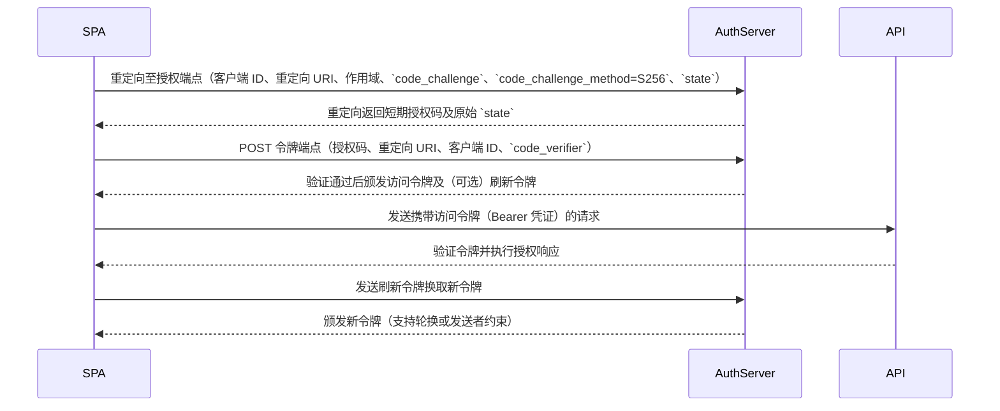

<p align="center">
  
</p>

<h1 align="center">magpie-translator</h1>

<p align="center">One model answers. A second model rewrites that final reply in the style of your prompt. The original stays in the session. The rewrite never does.</p>

<p align="center"><a href="README.zh-CN.md">中文</a> · <a href="docs/DESIGN.md">Design notes</a> · MIT</p>

Package name: `@magpie-community/page-translator`.

## What it does

A [magpie](https://github.com/yetone/magpie) plugin. After a reply finishes, the hook sends the final prose to a translator model you choose. The result shows on the **Translations** page in magpie's sidebar. It can also go to a log, a file, a desktop notification, or a webhook.

- The agent receives the original bytes. Nothing is written back into the session, so the next turn does not contain the rewrite.
- Fenced code stays as written. Masking is off unless you set `maskCode`. Afterwards, fenced blocks are put back from the original. Mermaid fences are never masked. A masked placeholder is put back only when it sits on its own line.
- The prompt is yours. Translation is one use. The same plugin can simplify, restructure, or change tone.
- A new install translates nothing until you add a rule.

The default task, used when `prompt` is empty, is:

```text
Rewrite the user's text into plain, easy-to-read {language}. Keep the meaning the same as the original. Do not add information that is not in the original. Do not add a preamble or a summary.
```

`{language}` is replaced with the language name (default `简体中文`). The settings box shows this same sentence. Saving it unchanged stores an empty prompt.

## Real examples

All runs happened on 2026-10-27 (11:10–11:29 AM PT) on a real magpie with plugin version 0.1.0 installed. The worker was `codex/gpt-6.1-sol`, called through the local gateway `127.0.0.1:3425`. The rewriter was `cursor/gemini-3.8-flash`, picked by the rule `gpt-*`. Each run used a temporary global `prompt`. All text is copied verbatim from the plugin's `log.jsonl`; it is only trimmed, never edited. Full outputs, exact prompts, `log.jsonl` line numbers, and the failures are in the [Chinese README](README.zh-CN.md#真实例子).

| # | Use case | What the rewrite produced | Worker / rewrite latency | Verdict |
| --- | --- | --- | --- | --- |
| 1 | Explain real code: Redis [`dictRehash`](https://github.com/redis/redis/blob/33c2a2a145d3f09b42503df27d3ffbc76f34e32c/src/dict.c#L406-L437), CPython [`_lru_cache_wrapper`](https://github.com/python/cpython/blob/d54c2d89b7a6b75bab996eacca22b85816f56762/Lib/functools.py#L653-L721), pillarjs/router [`Layer.prototype.match`](https://github.com/pillarjs/router/blob/098ea782ee6dadbedda778470a177ccd813c95a0/lib/layer.js#L265-L298) | An analogy (Redis: "moving a warehouse while it stays open"), a step-by-step "why", and a flowchart | 32.6/35.7 s, 28.2/45.3 s, 24.2/49.8 s | Much easier to read than the dense original. **Control:** GPT rewrote its own reply with the same prompt, through the plugin's own `translateJob`. It was just as accurate (latency 35.9/41.9/26.6 s), and its mermaid was valid. Gemini's flowcharts put backticked code into node labels and likely won't render. A second model gets you a different style or a lower cost, not guaranteed better quality. |
| 2 | Long prose code review → 🔴/🟡/🟢 checklist | 4 must-fix, 5 should-fix, and 3 nice-to-have items, one line each | 38.7 / 105.2 s | Strong |
| 3 | Agent's prose plan → TODO checklist | `- [ ]` items in 5 phases | 10.6 / 15.9 s | Strong |
| 4 | Work summary → Conventional Commit with `BREAKING CHANGE:`; a similar summary → stakeholder update | See below | 8.4/16.4 s; 9.7/11.9 s | Strong |
| 5 | Jargon-heavy migration advice → plain Chinese for a PM | 3 short points, no jargon | 15.3 / 19.8 s | Strong |
| 6 | Dense OAuth + PKCE prose → mermaid sequence diagram | 8 messages, in order | 8.6 / 26.8 s | Good |
| 7 | Same reply, two tones: terse senior engineer vs. warm mentor with an exercise | — | 14.0 s / 22.3 s | Shows the prompt in control. Terse mode placed code blocks mid-sentence. |
| 8 | Japanese translation; X thread; Socratic questions | — | 16.7 / 27.0 / 36.9 s | Japanese was clean. Two of the three posts ran over 140 characters (190 and 156). Socratic Q3 nearly gives away the answer. |
| ✗ | "Risk reviewer" that flags dangerous commands | Missed `rm -rf` and `DROP DATABASE` | 31.7 / 21.1 s | **Failed by design.** Code blocks are masked, so the rewriter never sees them. Don't write prompts that need to read code. |
| ✗ | Crash trace → one sentence + next steps | One over-long sentence with the code inlined | 74.9 / 98.5 s | Didn't help. GPT's self-rewrite had the same problem. |

Example 4, the commit message (verbatim):

```text
fix!: resolve session cache race condition and add payment retries

* Add a mutex in `session/store.go` to synchronize concurrent access to shared cache state
* Implement retry behavior with jitter in the payment client
* Bump Go version to 1.23
* Add six new tests
* Remove deprecated `/v1/login` endpoint

BREAKING CHANGE: The deprecated `/v1/login` endpoint has been removed. Consumers must migrate to a supported login endpoint. The project now requires Go 1.23.
```

Example 6, the sequence diagram (verbatim; the rewrite language was Chinese):



## Install

magpie 0.1.1273 or newer. The translator model must already work in magpie (`magpie models`).

```bash
magpie plugin add github:GameHoo/magpie-translator
magpie plugin list
```

Once this package is in the community registry, the install name is `@magpie-community/page-translator`. If a command says `no plugin`, use the name `magpie plugin list` prints: a GitHub install is `github:GameHoo/magpie-translator`, a path install is that path.

Open **Translator** in magpie's settings, add a rule (source model on the left, translator model on the right), and save. Or:

```bash
magpie plugin options <name-from-plugin-list> '{
  "language": "简体中文",
  "rules": [
    { "model": "gpt-*", "translator": "cursor/gemini-3.8-flash" },
    { "model": "*",     "translator": "your-provider/your-model" }
  ]
}'
```

`magpie plugin options` replaces the whole options object. The settings panel keeps fields it does not edit.

Rules match top to bottom and stop at the first hit. Omit `agent` or `model` to mean every client or every model. `model` is a case-insensitive glob (`gpt-*`, `deepseek/*`, `*gpt*`). `agent` is a whole word. A rule may set its own `language`, `prompt`, `style`, `display`, `webhookUrl`, and `rewriteSameLanguage`.

## Settings

The panel writes the same `options` object as the CLI, in magpie's `plugins.json`. The next reply uses the new settings.

| Panel | Field | Default | Notes |
| --- | --- | --- | --- |
| Switch | `enabled` | on | Off stops new rewrites. The plugin stays installed |
| Language | `language` | `简体中文` | A picker: 简体中文, 繁體中文, English, 日本語, 한국어, Español, Français, Deutsch, Português, Русский. Anything else snaps back to 简体中文 |
| Style | `style` | empty | Presets fill `{style}`: plain, keep terms, brief, detailed |
| Placement | `placement` | `beside` | History page only: `below`, `beside`, or `only` |
| Translator badge | `showTranslatorBadge` | on | Model and latency on the card |
| Collapse original | `collapseOriginal` | off | Only when placement is `below` |
| Skip same language | `rewriteSameLanguage` (inverted) | skip | A local script check. Unknown languages are still sent |
| Code stays put | — | checked | Fences are restored after the rewrite. `maskCode` is off unless you set it |
| Timeout | `translateTimeoutMs` | 120s | The slider stores 10–120s. The worker waits that long. The hook only enqueues and returns |
| History | `historyLimit` | 500 | 100, 500, 1000, 5000, or `0` to keep none |
| Rules | `rules` | `[]` | Empty means do nothing |
| Prompt | `prompt` | empty | Placeholders: `{language}` `{style}` `{model}` `{translator}` |

CLI-only: `display` (`log`, `file`, `stdout`, `notify`, `webhook`; default `["log"]`), `webhookUrl`, `magpieBaseUrl`, `maskCode` (default off), `allowRemoteExport` (default off). There is no `gatewayKey` field. A key is read only from `MAGPIE_TRANSLATOR_GATEWAY_KEY`, and only then is `Authorization` sent. `notify` and `webhook` run only when you list them in `display`, and only for a request whose origin is `local`, unless `allowRemoteExport` is on. This package does not set `gatewayTimeoutMs`, so the hook keeps magpie's own short limit. The model call is not inside the hook.

## History page

Sidebar → **Translations** (`翻译记录`).

- Success rate and median latency, search, and filters for agent, source model, translator, and status.
- Side-by-side original and rewrite, copy either side, and a note when code moved or text was clipped.
- **Compare** sends the same original to another model. **Retry** runs the same translator again. The page writes a small `_compare` object and does not send the history back. The worker reads that object itself. It does not wait for another reply.
- Failures and timeouts keep the original and the error. The plugin calls the model once. It does not retry.
- Copy the filtered rows as JSON or Markdown.
- If a write is over magpie's 64KiB options limit, the page shows the byte count in the toast and in `#jobError`, and it does not call `options.set`.

New rows are written under the data directory. This page cannot read that directory. The list stays empty until magpie can read a plugin's own files. Older `options.feed` data, if you still have it, still shows.

## Where data is stored

Full history stays on disk, mode `0600`:

- `$MAGPIE_TRANSLATOR_HOME`, or `$XDG_DATA_HOME/magpie-translator`, or `~/.local/share/magpie-translator/`
- `history.json` — full rows, including the text that was sent and the prompt used for compare. No gateway key
- `log.jsonl`, `latest.txt` (when `display` includes `file`), `compare-seen.json`
- `inbox/*.json` — one file per rewrite, removed when the worker takes it
- `feed.json` — a public slice, rewritten only when its JSON changes
- `worker.json` — pid and source hash of the detached worker

The hook and the worker do not write `plugins.json`. A settings save strips `gatewayKey`, `feed`, and `models` if they were left there. The page cannot read the data directory. `feed.json` is for you, and for a future magpie read. It is not copied into plugin options.

The original is sent only to the translator model you configured, through the local magpie gateway. The plugin opens no port of its own. Webhook and desktop notifications stay off unless you opt in, and they are skipped for anything that is not a local request. The body has no gateway key.

`historyLimit: 0` clears `history.json` on the next rewrite and does not backfill the log.

## How it runs

`onResponse` in `src/hooks.mjs` writes one job file and returns. It does not call a model. `onRequest` does not rewrite the body. It only marks the plugin's own request so that request is not queued again. `magpie plugin list` still prints `async gateway hook onRequest` for every async hook. That string is magpie's.

Magpie aborts a hook at `gatewayTimeoutMs` (at most 10 seconds; this package leaves the host default, which is shorter). A real rewrite takes longer than that, so the call runs in `src/worker.mjs`. That process is detached, writes only in the data directory, and waits up to `translateTimeoutMs` (10 seconds to 10 minutes, default 2 minutes). Loading the hook starts it, and so does a new job. An options write restarts the host, which loads the hook again, so compare and retry do not wait for some other reply.

There is no middleware. Bytes that pass through the gateway are not changed. A Codex stream whose `response.completed` has no output is still invisible.

The page is sandboxed: no network, no inline scripts. It may call `magpie.read` only for `providers:list` and `usage:summary`. Compare and retry are a small `magpie.options.set`. The payload drops `feed` and measures UTF-8 bytes. Over 60KiB it shows an error and does not write.

Magpie has no page read of a plugin data file, no page call into the gateway, and no plugin job API. Hooks, the page, and tools were all too short or pointed at the wrong place for a 12–105 second rewrite. The queue plus the detached worker is the path that finishes the call. The history page still cannot show the new rows. What is missing is a host read of the plugin's data directory, or a bridge call that can run a model without the 10 second hook cap.

Tool calls, reasoning, pure JSON, structured-output requests, title helpers, and (by default) text already in the target language are skipped. Text longer than 20,000 characters is cut. A code-only reply is sent when masking is off, because the code is the text. With `maskCode` on, a reply that is only code is skipped.

## Develop

```bash
HOME=$(mktemp -d) bun test
bun scripts/check.mjs
```

## License

[MIT](LICENSE)
