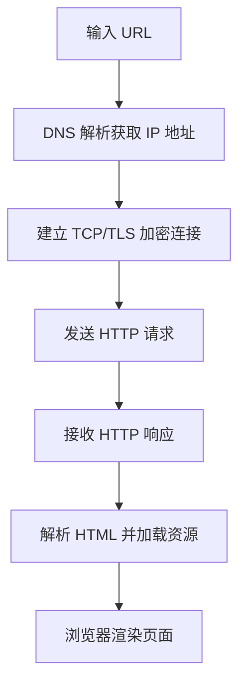

<p align="center">
  
</p>

<h1 align="center">magpie-translator</h1>

<p align="center">一个模型干活，另一个模型按你的提示词把它的最终回复「转述」一遍：说人话、换语气、换语言、加结构、加图示都行。原文照常回到会话，转述一个字也不进去。</p>

<p align="center"><a href="README.en.md">English</a> · <a href="docs/DESIGN.md">设计与核验记录</a> · MIT</p>

---

## 它是什么

[magpie](https://github.com/yetone/magpie) 的插件。核心不是「翻译」，而是一层通用的**转述层**：

- 工作模型（比如 Codex 背后的 GPT）照常回答，agent 收到的是原文，会话历史不变；
- 这一轮结束后，插件把最终回复交给你选的**第二个模型**，按**提示词**重新表达一遍；
- 转述结果放在 magpie 侧栏的「翻译记录」页（也可以写到日志、文件、通知、webhook），**永远不进原会话**，下一轮请求里也没有它；
- 代码块、行内代码和 `$ ` 开头的命令先换成占位符，转述完原样放回。

翻译只是其中一种用法。提示词换一换，同一个插件就能：

| 想要的效果 | 提示词大意 |
| --- | --- |
| 说人话 | 把技术回答改成非程序员也看得懂的话 |
| 换语言 | 忠实翻译成 `{language}` |
| 加结构 / 加图示 | 一句结论 + 要点列表 + 一张 mermaid 流程图 |
| 换语气 | 像给初学者讲一样，温和、带个生活类比 |

> 关于「加图」：插件只是把第二个模型的输出原样存下来。模型能写出 mermaid 代码块或 Markdown 图片链接，但**能不能画出来取决于显示的地方**（GitHub 会渲染 mermaid；「翻译记录」页是否渲染 mermaid / 外链图片请以实际为准）。插件不会自己生成图片。

## 提示词怎么配（以代码为准）

- **全局提示词** `prompt`：替换默认任务句。可用变量 `{language}`、`{style}`、`{model}`（原始模型）、`{translator}`（转述模型）。设置页里没改过时显示的就是这句，不改它保存成空值，翻译时把 `{language}` 换成语言名：`Rewrite the user's text into plain, easy-to-read {language}. Keep the meaning the same as the original. Do not add information that is not in the original. Do not add a preamble or a summary.`
- **风格** `style`：追加在提示词后面的一段要求。面板有四个预设：直白人话、保留术语、简洁、详细；也可以自己写。
- **每条规则单独覆盖**：规则里可以写自己的 `language`、`prompt`、`style`、`display`、`webhookUrl`，比如 GPT 的回复用 A 提示词交给模型 X，其他模型用 B 提示词交给模型 Y。
- 不管怎么改，插件都会保留：防回环的内部标记、「占位符原样保留」规则、「只输出改写后的内容」。

## 真实例子

以下 4 个例子是 2026-10-27 在真实 magpie（DF03 机器）上跑出来的：请求通过本机网关 `127.0.0.1:3425` 发给 `codex/gpt-6.1-sol`，插件按规则 `gpt-*` 交给 **`traex/gemini-3-flash`** 转述，原文和转述取自插件的 `log.jsonl`。只做了截断（标 `…`），没有改字。

### 例 1：说人话（技术回答 → 通俗中文）

提示词：`Rewrite the user's text into plain, easy-to-read {language} that a non-programmer can follow. Keep code unchanged.`

原文（GPT，节选）：
> A database index is an auxiliary data structure, typically a B-tree or hash table, that maps indexed column values to row locations. It speeds up reads by letting the query optimizer use an index scan or seek instead of a full table scan. …

转述（Gemini，节选）：
> 数据库索引就像是书的目录，通常采用 B-tree 或哈希表结构，将数据的值对应到它在表中的具体位置。它能让数据库在查询时直接跳到目标位置，而不需要扫描整张表，从而显著提高读取速度。…
>
> 然而，索引会使写入速度变慢。因为每当你执行 INSERT、UPDATE 和 DELETE 操作时，数据库都必须同步维护所有相关的索引。…

### 例 2：翻译（英文 → 中文，代码不动）

提示词：`Translate the user's text into {language} faithfully. Keep the original structure and code.`

原文（节选）：
> `git rebase -i HEAD~3` starts an **interactive rebase** of the last three commits on your current branch. It lets you reorder, combine, edit, or remove those commits. …
>
> Change the second `pick` to `squash` to combine C with B. Save and close; Git prompts you to edit the combined commit message, then replays D.

转述（节选）：
> `git rebase -i HEAD~3` 会启动当前分支最后三个提交的**交互式变基**。它允许你对这些提交进行重新排序、合并、编辑或删除。…
>
> 将第二个 `pick` 改为 `squash`，以将 C 合并到 B 中。保存并关闭；Git 会提示你编辑合并后的提交信息，然后重新应用 D。

### 例 3：加结构 + mermaid 图

提示词：``Summarize the user's text in {language} as: a one-line conclusion, a bullet list of key points, then a ```mermaid flowchart``` diagram of the process.``

原文（节选）：
> When you type an HTTPS URL into your browser, several steps happen:
> 1. **Find the server.** The browser checks its cache or uses DNS … 2. **Establish a secure connection.** … 5. **Display the page.** …

转述（完整，未截断）：

访问 HTTPS 网站的过程是从域名解析开始，通过建立安全加密连接来请求和接收数据，最终由浏览器渲染出网页的完整流程。

*   **查找服务器**：浏览器通过缓存或 DNS 系统将域名转换为 IP 地址。
*   **建立安全连接**：通过 TCP 连接和 TLS 握手验证服务器身份并加密通信（HTTP/3 则使用集成的 QUIC 协议）。
*   **发送请求**：在加密通道中发送包含路径、请求头和 Cookie 的 HTTP 请求。
*   **接收响应**：服务器处理请求并返回包含状态码、响应头和 HTML 内容的数据。
*   **显示页面**：浏览器解析 HTML，获取 CSS、JS 等资源，计算布局并完成页面渲染。



### 例 4：换语气（讲给初学者听）

提示词：`Retell the user's text in {language} for a complete beginner, in a warm, encouraging tone, using one everyday analogy. Keep code unchanged.`

原文（节选）：
> A **race condition** occurs when a program's result depends on the unpredictable timing of concurrent operations. For example, two threads may read the same counter value, both add one, and then both write the same result. One increment gets lost. …

转述（节选）：
> 嘿！别担心，编程中的一些概念听起来很高级，但其实和我们的日常生活很像。
>
> 想象一下你和好朋友正在一起往存钱罐里存钱。存钱罐旁边有一张小纸条记录着总金额，现在写着“10元”。…
>
> 为了不让辛苦存的钱变没，我们可以给纸条加一把“魔法锁”，也就是 `threading.Lock`。…

（这次实测里，Python 代码块被原样保留，但模型把它放进了一句话中间：「这种情况就像 ```python … ``` 展示的一样」。代码本身没改，只是位置受模型和提示词影响。）

## 界面预览

> 下面两张是**设计稿截图（design preview）**，不是 magpie 里的实拍，实际界面可能略有出入。


## 安装

你需要：

- 本机正在运行的 magpie，版本 0.1.1273 或更新（`magpie version` 可查；本文按 0.1.1731 核对）；
- 打算拿来翻译的模型已经能在 magpie 里用，也就是 `magpie models` 能列出来；
- Node.js 20+。只有跑测试或手动打开本机网页时才需要，hook 由 magpie 自带的 Bun 运行。

```bash
magpie plugin add github:GameHoo/magpie-translator
magpie plugin list                       # 查看插件名
```

也可以在 magpie 的 **插件 → 发现 → 非官方插件 · GitHub** 里找到并安装：magpie 会搜索打了 `magpie-plugin` topic 的仓库（不含 fork 和已归档仓库，最多每十分钟刷新一次）。

开关与更新：

```bash
magpie plugin off magpie-translator      # 关闭
magpie plugin on  magpie-translator      # 打开
magpie plugin update                     # 更新所有插件
```

> magpie 按包名 `magpie-translator` 查找插件。如果提示 `no plugin`，改用 `magpie plugin list` 印出的名字：从 GitHub 装的是 `github:GameHoo/magpie-translator`，从本地目录装的是那条路径。

## 快速配置

**刚装好时规则是空的，什么都不翻译。** 至少要加一条规则。

最省事的办法是打开 magpie 设置里的 **翻译设置**，点「添加规则」，左边选原始模型，右边选翻译模型，然后保存。

也可以用命令行配置：

```bash
magpie models                            # 每一行 provider/model 都可以当翻译模型

magpie plugin options magpie-translator '{
  "language": "简体中文",
  "rules": [
    { "model": "gpt-*", "translator": "traex/gemini-3-flash" },
    { "model": "*",     "translator": "grok/grok-4.7-build-fast" }
  ]
}'
```

上面的翻译模型 id 只是举例，换成你自己 `magpie models` 里的任意一行。规则从上往下匹配，命中第一条就停：这个例子里 GPT 系列交给 Gemini，其余模型交给 Grok。

配好后，让 Codex、Claude Code 之类的客户端照常通过 magpie 答一轮，再打开 magpie 侧栏的 **翻译记录**。

> ⚠️ `magpie plugin options` 会**整体替换**插件配置，不会和上一次合并，没写的字段会回到默认值。用设置面板保存时，面板上没有的字段会原样保留。

### 规则怎么匹配

| 写法 | 匹配范围 |
| --- | --- |
| 不写 `agent` / `model` | 所有客户端 / 所有模型（面板里叫「所有模型」） |
| `"model": "gpt-5.4"` | `gpt-5.4`、`openai/gpt-5.4`，不分大小写；不匹配 `gpt-5.4-mini` |
| `"model": "gpt-*"` | 完整 id 或最后一段以 `gpt-` 开头的模型 |
| `"model": "deepseek/*"` | 这个 provider 下的所有模型（面板里叫「所有 deepseek/*」） |
| `"model": "*gpt*"` | `*` 可以放在任意位置；`?` 只当普通字符 |
| `"agent": "codex"` | 客户端名整词匹配，不分大小写，以记录卡片上显示的名字为准 |

每条规则都能单独设置 `language`、`prompt`、`style`、`display`、`webhookUrl` 和 `rewriteSameLanguage`。面板里的「高级」可以覆盖语言和提示词。

## 设置说明

面板位置：magpie 设置 → **翻译设置**（英文界面叫 Translator）。面板和命令行改的是同一份配置，也就是 `plugins.json` 里这个插件的 `options`。保存后，下一条回复就按新设置走，不用重启 magpie。

| 面板项 | 字段 | 默认 | 说明 |
| --- | --- | --- | --- |
| 右上角开关 | `enabled` | 开 | 关掉后插件不再翻译，但仍保持安装 |
| 目标语言 | `language` | `简体中文` | 写任何人看得懂的语言名都可以，比如 `English`、`日本語`、`Français` |
| 风格 | `style` | 直白人话 | 四个预设：直白人话、保留术语、简洁、详细。会填进提示词里的 `{style}` |
| 译文位置 | `placement` | 并排 | 只影响「翻译记录」页的展示方式：原文下方、并排、仅译文 |
| 显示翻译模型标签 | `showTranslatorBadge` | 开 | 在译文角落标出翻译模型和耗时 |
| 默认折叠原文 | `collapseOriginal` | 关 | 只在「原文下方」模式下生效 |
| 原文已是目标语言时跳过 | `rewriteSameLanguage`（取反） | 跳过 | 在本机检测语言，跳过的回复不调用模型。认不出的语言一律照常翻译 |
| 代码块与命令保持原样 | — | 始终开启 | 这一项不能关 |
| 超时 | `translateTimeoutMs` | 120 秒 | 面板上可选 10～120 秒，命令行最大可设 600 秒 |
| 翻译记录保留 | `historyLimit` | 500 条 | 面板可选 100、500、1000、5000 条或「不保存」(`0`)，记录存在本机 |
| 翻译规则 | `rules` | `[]` | 拖动或用箭头调整顺序。原始模型可以选具体模型、「所有模型」或「所有 provider/*」 |
| 提示词 | `prompt` | 空 | 编辑框里先显示上面那句英文默认任务句。不改它就保存成空值，翻译时用的还是这一句。可以插入 `{language}`、`{style}`、`{model}`、`{translator}`，下方有实时预览。点「恢复默认」会还原 |

关于提示词：编辑框里显示的默认句和代码里的默认任务句是同一句。不改它直接保存时，配置里写的是空值，翻译时再把 `{language}` 换成语言名：

```text
Rewrite the user's text into plain, easy-to-read {language}. Keep the meaning the same as the original. Do not add information that is not in the original. Do not add a preamble or a summary.
```

不管提示词怎么改，插件都会保留三样东西：一个内部标记（用来防止翻译请求被再翻译一遍）、占位符规则，以及 `Output only the rewritten text.` 这句要求。

以下字段只能在命令行里改：`display`（另外把译文写到 `log`、`file`、`panel`、`stdout`、`notify`、`webhook`，默认 `["log"]`）、`webhookUrl`、`localPanel`、`panelPort`（默认 44721）、`gatewayKey`、`magpieBaseUrl`。

## 翻译记录页

位置：magpie 侧栏 → **翻译记录**（英文界面叫 Translations）。

- **列表**：每条记录显示 agent、状态（成功、失败、超时、已跳过）、时间和「原始模型 → 翻译模型」。顶部汇总成功率和中位延迟。支持按关键词搜索原文和译文，也能按 Agent、源模型、翻译模型、状态筛选。
- **详情**：原文和译文按段落对齐，同步滚动。可以一键复制原文或译文。代码块会标出是「原样保留」还是「译文改了代码」。原文太长被截断时也会提示。
- **用其他模型对比**：选另一个翻译模型，把同一段原文再翻译一遍，结果和原译文并排放着。觉得哪个更好，就点「这个更好」。
- **失败与超时**：翻译模型报错或超时，记录会留下原文和错误信息，可以点「重试」，或「换个模型重试」。超时、断连以及 HTTP 408 / 429 / 5xx 会先自动重试一次，第二次还失败就会标注 `（已重试一次）`。
- **导出**：把当前筛选结果复制成 JSON 或 Markdown（原文和译文对照），也可以只复制当前这一条。

## 工作原理

```
客户端 ──► magpie 网关 ──► 工作模型
              │  原文照常流回客户端（插件不改字节）
              ├─ middleware onEvent：Responses 流的 completed 事件缺正文时补上
              ├─ hook onRequest：认出插件自己发的翻译请求，并接收「对比 / 重试」任务
              └─ hook onResponse：抽出最终正文 → 屏蔽代码 → 写进本机收件箱
                                               │
                         后台 worker（node src/panel.mjs）
                           └─► POST 127.0.0.1:3425/v1/chat/completions（model = 翻译模型）
                                 └─► history.json → ui/feed.js → 「翻译记录」页
```

- **hook**：翻译在 `onResponse`。`onRequest` 不改请求，只认出插件自己的翻译请求，并接收对比和重试。两者都在 `src/hooks.mjs`，由 magpie 用 Bun 运行。`src/middleware.mjs` 导出 `onEvent`，在网关进程里运行。翻译等这一轮结束后才开始，不拖慢 agent。
- **工人**：`node src/panel.mjs`。`panel.pid` 里写下进程号、插件版本、源码哈希和安装目录。更新之后对不上就停掉旧进程再起一个，这样 `ui/feed.js` 和 `ui/catalog.js` 会写进新目录。启动时把 `log.jsonl` 里还没有写进 `history.json` 的行补进翻译记录。`magpie plugin off` 之后工人看到 `plugins.json` 里这条是关的，手头的任务做完就退出。
- **页面和面板在沙箱里**：magpie 把插件页面放进 `sandbox allow-scripts` 的 iframe，不允许 `fetch`、WebSocket 和内联脚本。所以 worker 把模型目录写成 `ui/catalog.js`，把最近的记录写成 `ui/feed.js`，页面用 `<script>` 加载。保存设置、对比和重试走的是 magpie 提供的 `magpie.options.set`。插件只申请了 `providers:list` 和 `usage:summary` 两项只读权限。
- **出错不影响原流程**：插件出了任何问题，agent 照样拿到原文。

只翻译给人看的最终正文。工具调用、推理和 thinking 都不翻译。以下几种情况会跳过：整段回复是 JSON 或请求要求结构化输出、标题或摘要之类的辅助请求、只有代码、原文已经是目标语言。屏蔽代码后如果正文超过 20000 字，超出部分会截掉，页面上会提示。

## 隐私

- 原文只会发给你在规则里选的翻译模型，经本机 magpie 网关转发。插件本身不连接任何外部服务。
- 记录保存在本机，默认在 `~/.local/share/magpie-translator/`（`history.json`、`log.jsonl` 等），可以用 `MAGPIE_TRANSLATOR_HOME` 或 `XDG_DATA_HOME` 换位置。「翻译记录保留」设为「不保存」时，不写历史记录。页面读取的 `ui/feed.js` 里没有 gateway key 和提示词。
- 本机网页（`127.0.0.1:44721`）默认关闭，打开后也只监听 `127.0.0.1`。
- `webhook` 出口默认不启用。启用后会把译文 POST 到你填的地址，内容里不含 gateway key。

## 常见问题

**装好了，但什么都没翻译？**
规则默认是空的，先加一条。再确认规则里的原始模型能匹配上工作模型的 id（写法参照 `magpie models` 的输出），还有右上角的开关是开着的。

**用 `plugin options` 改了一项，别的设置没了？**
命令行写入会整体替换。要么把完整 JSON 一起写进去，要么改用设置面板。

**记录显示「失败」或「超时」？**
先看卡片上的错误信息。确认翻译模型在 magpie 里能用，必要时把超时调大，然后点「重试」或「换个模型重试」。

**中文回复没有被翻译？**
原文已经是目标语言时默认跳过。如果想把它也改写得更直白，把「原文已是目标语言时跳过」关掉。

**点了「对比」或「重试」没反应？**
这两个任务在下一次经过 magpie 的请求时才会开始（页面会提示「已提交，钩子重载后开始」）。如果 worker 没在运行，就要等下一轮对话。

**`magpie plugin list` 显示 `async gateway hook onRequest`？**
这行字是 magpie 对所有异步 hook 写死的，它不读取插件导出的函数名。翻译在 `onResponse`：抽出最终正文，屏蔽代码，放进收件箱。`onRequest` 不改请求体，只认出插件自己发出的翻译请求，并收下对比和重试。

**Codex 用 ChatGPT 账号登录时抓不到正文？**
这条路径不经过 middleware。如果它的 `response.completed` 不带正文，插件就看不到这一轮。详见 [docs/DESIGN.md](docs/DESIGN.md)。

## 开发

```bash
npm test                               # 单元测试
MAGPIE_BIN=/path/to/magpie npm run e2e # 走一遍真实的 magpie 网关
npm run demo                           # 可选的本机网页 + 假翻译器，不需要任何 key
```

## 许可

[MIT](LICENSE)
