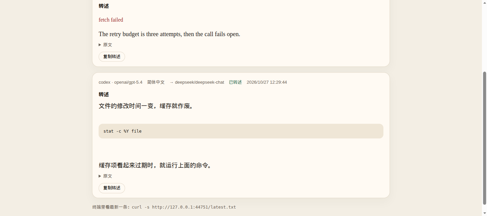
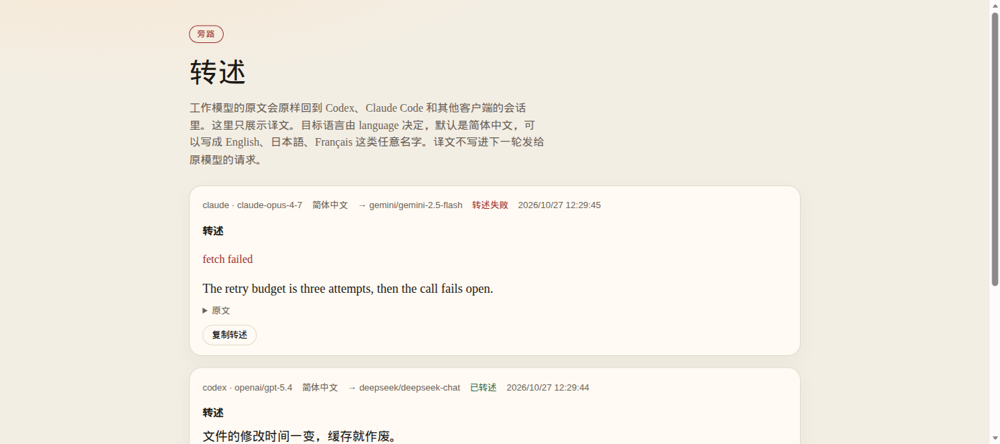
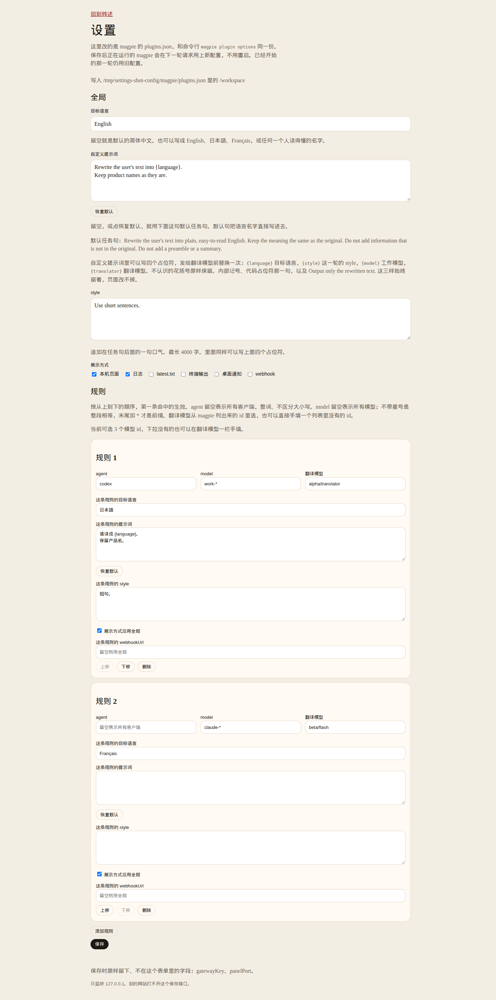

# magpie-translator

这个插件用你已经在 magpie 里配好的另一个模型，翻译选定工作模型的最终回复。`language` 可以写成任意语言名。agent 拿到的仍是原文，下一轮发回工作模型的请求里没有译文。

不写 `language` 时，默认是 `简体中文`。一条规则可以改成 `English`、`日本語`、`Français`，或任何一个人读得懂的名字。默认提示词是英文指令，把这个名字嵌进去，不假设译文必须是中文。

设置和翻译记录都在 magpie 里：设置面板，以及用来对照原文和译文的侧栏页。`127.0.0.1:44721` 默认不开，除非 `display` 里有 `panel`，或 `localPanel` 为 true。`npm test` 是 51 项，最近一次在 2026-10-27 跑过。那次没有打开 Codex，也没有打开 magpie 的窗口。两个页面是用浏览器打开静态文件看过的（`http://127.0.0.1:44731/`：设置页浅色和深色、模型选择器、记录页对照、超时卡片、窄屏标签），不是在 magpie 窗口里打开的。

English: [README.md](README.md). Design notes and the checks that were run: [docs/DESIGN.md](docs/DESIGN.md). Checked on 2026-10-27.

## 装上并写一条规则

需要本机已经在跑的 magpie，版本 0.1.1273 或以后，以及 Node.js 20 或以上（跑测试和手动打开页面时用）。`magpie version` 会印出版本。本文按 0.1.1731 核对。magpie 用它自带的 Bun 跑 hook。hook 是 magpie 在一轮请求之后调用的插件入口，不用你自己启动。

1. 看翻译模型的 id。下面命令印出的 `provider/model` 都能填，包括插件提供的 provider：

   ```bash
   magpie models
   ```

   想用的模型不在列表里时，先加上它的 provider，再列一次。magpie 已经认识的厂商可以这样加：`magpie provider add deepseek sk-...`。其他字段看 `magpie provider --help`。

2. 从仓库装上。下一步的 `<名字>` 用 `plugin list` 印出来的那一项：

   ```bash
   magpie plugin add github:GameHoo/magpie-translator
   magpie plugin list
   ```

   本地目录同样可以：`magpie plugin add /path/to/magpie-translator`。这时名字就是那条路径。

3. 写规则。`translator` 用第 1 步的 id。`model` 可以是那条 id，也可以是带 `*` 的式样：`*` 能出现在任意位置，匹配不区分大小写。下一节有例子。`rules` 为空时什么都不翻译。下面的例子把命中的工作模型译成英文，把 Claude 译成日文。`gpt-5*` 和 `claude-*` 是式样，不是从 `magpie models` 原样抄下来的一行。这里的 `display` 只有日志。要看的记录在 magpie 侧栏，不依赖本机网页：

   ```bash
   magpie plugin options <名字> '{
     "language": "English",
     "style": "Use short sentences.",
     "display": ["log"],
     "translateTimeoutMs": 120000,
     "rewriteSameLanguage": false,
     "historyLimit": 500,
     "rules": [
       { "model": "gpt-5*", "translator": "deepseek/deepseek-chat" },
       { "model": "claude-*", "translator": "gemini/gemini-2.5-flash", "language": "日本語" }
     ]
   }'
   ```

   只译成法文的一条规则：

   ```json
   { "model": "gpt-5*", "translator": "deepseek/deepseek-chat", "language": "Français" }
   ```

   交给 `plugin options` 的 JSON 会整份替换插件配置，不会和上一份合并。下一轮结束的回复使用新的 `language`。改语言不用重启 magpie。每轮原文只翻译一次，译成这条规则的语言。译文不会送回工作模型，所以不会再被译成第二种语言。

4. 让工作模型经 magpie 回答一轮。把 magpie 已经在路由的客户端（Codex、Claude Code 或其他客户端）指到 magpie，再问它一句。然后打开 magpie 侧栏里标题为「翻译记录」的那一页。还没有命中的回复时，页面上写着还没有译文。命中之后，一行里有 agent、工作模型、翻译模型、语言、耗时和时间。页面上的按钮和说明是中文。译文用的是这一行的 `language`，不是页面外壳的语言。

`magpie plugin list` 仍会印 `async gateway hook onRequest`，窗口空闲时写 Waiting for a request。这两句是 magpie 自己的文案。本插件同时导出了 `onResponse`。它不调用 `ctx.report`，那是给往上下文里插内容的插件用的。

下面两张图是可选的本机页面，不是 magpie 侧栏。2026-10-27 用 `npm run demo` 打开，窗口宽 1440 像素。标题和按钮是中文。卡片上的语言行是这一轮的 `language`，这两张图里是 `简体中文`。图脚的端口是 44751，因为那次运行设置了 `MAGPIE_TRANSLATOR_PORT`。不设端口时，`npm run demo` 用 44721。`npm run demo` 会为那一次打开本机页面。正常安装默认不开。

翻译完成时，围栏里的命令保持原样。文件：`docs/panel_success.png`。



翻译模型连不上时，卡片留下原句，并写出错误。文件：`docs/panel_failure.png`。



`npm run demo` 用的是本机假的翻译模型，所以这次失败是连不上。真实翻译模型返回错误时，错误文字出现在同一位置。

`package.json` 里的 `magpie.options` 只是示例。生效的是 `magpie plugin options` 写进去的那份。

## magpie 里的设置和记录

设置在插件的 settings 槽（`ui/settings.html`，中文标题「翻译设置」）。记录在插件自己的侧栏页（`ui/history.html`，中文标题「翻译记录」）。两个文件都在 `ui/`，并共用 `ui/style.css` 和 `ui/app.js`。magpie 不允许页面 `fetch`、开 WebSocket、提交表单，或写内联脚本，所以这两个页面只引用同目录里的脚本，包括 `_magpie/bridge.js`。

插件图标文件是 `ui/icon.svg`：靛蓝圆角方块（`#5b5bd6`，带一条同色渐变）加白色翻译标记。笔画是 `#ffffff`，不用 `currentColor`，浅色和深色列表上是同一张图。2026-10-27 在 `#fafafa` 和 `#0b0b0c` 上以 64、20、16 像素打开过。`magpie.icon` 是这张图的 `data:image/svg+xml` URI（1255 字符），解出来与文件逐字相同，用在 Discover 和已安装插件那一行。`magpie.page.icon` 是 `ui/icon.svg`，magpie 收成页面目录里的 `icon.svg`，侧栏入口用它。magpie 的面板结构没有 icon 字段（`internal/plugin/page.go` 的 `PanelSpec` 只有 slot、title、titles、file）。设置槽因此没有单独的图标，标题就是面板标题。这台机器没有 magpie 窗口，所以插件列表、Discover 和侧栏本身没有点开。

工人在这两个页面旁边写两个文件：

- `ui/catalog.js` 是本机网关 `/v1/models` 的模型列表。网关列不出来时改用 `magpie models`。大约每分钟刷新一次。
- `ui/feed.js` 是页面上的近期记录。不写进 `plugins.json`。options 一变，magpie 就会重载 hook 宿主，所以翻译本身不能去改 options。

`providers:list` 只有 provider 的 id 和名字，没有模型 id。模型选择器把 `catalog.js` 和 `usage:summary` 里的具体 id 按这些 provider 分组。来源规则还可以选「所有模型」或「这一家的全部」（`providerId/*`）。没有手填模型的输入框。规则上已经保存的 id，即使目录还没列出，也会留在选择器里。

保存时调用 `magpie.options.set`，并带上原先的 options，所以 `gatewayKey`、`panelPort`、`magpieBaseUrl`、`gatewayTimeoutMs` 还在。普通保存会丢掉还没处理的 `_compare`。保存会让钩子重载一次。下一条结束的回复用新配置。Bun hook 自己不调用 `magpie.options.set`。`options.set` 串行执行，两次之间至少隔 1.1 秒。

记录上的「用其他模型对比…」另选一个翻译模型，并设置一次 `_compare`。工人用存着的原文再译一次，结果加在同一条的对照栏，不新开一条，也不再写一次 plugins.json 去清掉 `_compare`。「重新翻译」和「重试」带上 `_compare.replace`，改的是这一条自己的译文。工人没在跑时，要等下一次被钩住的请求才会开始。页面不能下载文件（沙箱没有下载权限）。导出是把 JSON 或 Markdown 复制到剪贴板；剪贴板被拒绝时再试 `document.execCommand("copy")`。

记录页把段落、列表和代码块排成同一行的格子，各栏一起滚动。宽度不超过 760 像素时，这些栏变成标签。超时和其他失败用真实的错误文字画卡片。记录里没有 token 数，也没有网关请求 id，设计稿上的这两项因此不显示。

历史在数据目录的 `history.json`。默认留下最近 500 条。面板可选 100、500、1000、5000，以及「不保存」（`0`，下一次翻译会把文件清空）。其他正数夹在 20–5000。页面读到的脚本里没有网关钥匙、遮罩后的正文、占位符、提示词和 magpie 地址。脚本里有 `style`，用来显示风格名。

下面这张图是可选的本机设置页，2026-10-27 拍摄，不是 magpie 面板。文件：`docs/panel_settings.png`。



本机页面默认关。`"localPanel": true`，或 `display` 里加上 `panel`，然后打开 <http://127.0.0.1:44721/settings>（端口以 `panelPort` 为准）。它改的是同一条 `plugins.json`，只监听 127.0.0.1。表单没提交的字段按原值留下，所以旧表单不会清掉超时和历史条数。文件怎么对上这条插件，写在 [docs/DESIGN.md](docs/DESIGN.md)。

## 规则怎么匹配

规则按书写顺序，第一条命中的生效。

| 写法 | 命中 |
| --- | --- |
| 省略 `agent` | 所有客户端 |
| 省略 `model` | 所有模型 |
| `"model": "gpt-5.4"` | `gpt-5.4` 和 `openai/gpt-5.4`，不区分大小写。不命中 `gpt-5.4-mini` |
| `"model": "gpt-5*"` | 完整 id 或最后一段以 `gpt-5` 开头 |
| `"model": "*gpt*"` | `*` 可以在任意位置。`acme/foo-gpt-bar` 命中。`?` 仍是字面量 |
| `"model": "deepseek/*"` | 完整 id 以这家 provider 开头的模型。只写最后一段对不上 |
| `"agent": "codex"` | 整词，不区分大小写 |

`agent` 要和页面卡片上显示的名字一致。限定某个客户端之前，可以先只写 `model`，看卡片上的名字，再补上 `agent`。

同一条规则可以盖过全局的 `language`、`prompt`、`style`、`display`、`webhookUrl`。规则上不写 `language` 就沿用全局。全局也省略时，用默认的 `简体中文`。

厂商的 API key 仍放在 `magpie provider` 里。本机 magpie 没有要求特定的本地钥匙时，不要填 `gatewayKey`，工人会发送默认的 `magpie-translator`。你若已经配了具名网关钥匙，把同一串写进 `gatewayKey`。

## 语言、提示词和出口

| 字段 | 默认 | 说明 |
| --- | --- | --- |
| `language` | `简体中文` | 嵌进默认提示词的语言名。任意名字都可以，如 `English`、`日本語`、`Français` |
| `prompt` | 空 | 只换掉任务句，最长 4000 字。自定义句子里可以写 `{language}`、`{style}`、`{model}`、`{translator}`，发给翻译模型前替换一次。不认识的 `{token}` 原样留下。三样仍在：用来避免翻译请求再被翻译的内部记号、占位符规则、`Output only the rewritten text.` |
| `style` | 空 | 追加一句口气，最长 4000 字 |
| `display` | `log` | 见下表。这不关掉 magpie 里的记录页 |
| `panelPort` | `44721` | 本机页面的端口，只有打开本机页面时才监听，且只监听 127.0.0.1 |
| `localPanel` | false | `display` 里没有 `panel` 时也打开本机页面 |
| `webhookUrl` | 空 | `display` 含 `webhook` 时使用，须是 http 或 https |
| `translateTimeoutMs` | `120000` | 一次翻译调用的上限，夹在 10–600 秒。超时、连接中断，或 HTTP 408、429、5xx 会再试一次。其他 4xx 不重试。第二次失败的文字末尾是 `（已重试一次）` |
| `rewriteSameLanguage` | false | 为 false 时，原文已经是目标语言就不再送去翻译。规则上写了同一个字段就以规则为准。认不出的语言名仍会翻译。认得出的包括简体中文、繁体中文、English、日本語、한국어等。法文和其他拉丁字母语言不会被当成英文 |
| `historyLimit` | `500` | `history.json` 留下的条数。`0` 表示不保存，下一次翻译会清空文件。其他数字夹在 20–5000 |
| `enabled` | true | 页头的开关。`false` 时不再翻译新回复。这不是 magpie 自己的插件停用开关，页面改不了那个。已有记录的对照翻译仍会跑 |
| `placement` | `beside` | 只影响翻译记录页：`beside` 并排，`below` 原文在下，`only` 只看译文。不改 Agent 会话，会话里仍是原文 |
| `showTranslatorBadge` | true | 在记录栏上显示翻译模型 id 和耗时 |
| `collapseOriginal` | false | `below` 时默认折叠原文 |

设置里的提示词框显示一段中文模板，里面有 `{language}`、`{style}`、`{model}`、`{translator}`。不改这个框就保存，`prompt` 仍是空，钩子继续用下面的英文任务句。改过之后，框里的文字会换掉任务句。四张风格卡片把一句英文写进 `style`（直白人话、保留术语、简洁、详细）。超时滑块是 10、20、30、60、90、120 秒。命令行设的更大值会留着，直到你拨动滑块。

默认任务句会把语言名字直接写进去。`language` 为 `English` 时，这一句是：

`Rewrite the user's text into plain, easy-to-read English. Keep the meaning the same as the original. Do not add information that is not in the original. Do not add a preamble or a summary.`

默认句里不再留着 `{language}` 这四个字。只有你自己写的 `prompt` 或 `style` 里，才用 `{language}` 表示「这里换成这一轮的目标语言」。

这两句始终保留：

`Placeholders such as ⟦0⟧ and ⟦1⟧ stand for code or commands. Keep each one exactly where it is, including the brackets and the number. Do not translate, delete, or move them.`

`Output only the rewritten text.`

| `display` 的值 | 去哪看 |
| --- | --- |
| `panel` | 浏览器打开 `http://127.0.0.1:44721`（或你的 `panelPort`） |
| `log` | `~/.local/share/magpie-translator/log.jsonl` |
| `file` | 同一目录的 `latest.txt`，`tail -f` 可当终端面板 |
| `stdout` | 前台运行 `node src/panel.mjs` 时打在终端。由 hook 拉起时标准输出是丢掉的 |
| `notify` | `notify-send`。没有这个命令就跳过 |
| `webhook` | 向 `webhookUrl` POST JSON。正文里没有网关钥匙 |

数据目录可以用 `MAGPIE_TRANSLATOR_HOME` 或 `XDG_DATA_HOME` 改。默认是 `~/.local/share/magpie-translator`。

改了 `panelPort` 之后，结束该目录 `panel.pid` 里的进程，下一轮回复会按新端口拉起。hook 拉起的工人只有在该任务的 `display` 含 `panel`，或 `localPanel` 为 true 时才监听。自己运行 `node src/panel.mjs`、且没有设置 `MAGPIE_TRANSLATOR_DISPLAY` 时，会打开页面。

页面打不开时，在含有 `src/panel.mjs` 的目录里、用同一个用户执行：

```bash
node src/panel.mjs
```

用路径装上时，`magpie plugin list` 印出的就是这个目录。用 github 装上时，`plugin list` 印出 `github:GameHoo/magpie-translator`，那是交给 `plugin options` 的名字，不是目录。文件在 `~/.config/magpie/plugins/node_modules/magpie-translator`。设置了 `XDG_CONFIG_HOME` 时，把 `~/.config` 换成它。在那个目录里运行 `node src/panel.mjs`。两种装法都和 hook 共用上面的数据目录，会把收件箱里的任务译出来。

## 哪些字会送去翻译

只送面向用户的最终正文。工具调用、推理、思考块不送。magpie 给每个请求标四种 JSON 形状之一：`chat`、`responses`、`anthropic`、`gemini`。Codex 通常是 `responses`。Claude Code 是 `anthropic`。普通聊天应用是 `chat`。

下面这些不翻译：

- 整段回复就是 JSON，包括单独一层 ` ```json ` 围栏。Codex 的标题和建议助手就是这种形状。
- 请求要求结构化输出（`response_format`、`text.format`、Gemini 的 `responseMimeType: application/json`，或带 schema）。
- 请求是标题、摘要、建议或描述助手（例如 metadata 里的 `thread_title`、schema 名字，或一句很短的同类说明）。
- 请求有对话的形状，但没有用户轮次。只有 `{ "model": "..." }` 的请求不会因此被跳过。
- 原文已经是目标语言，且 `rewriteSameLanguage` 为关。

有工具调用时，`anthropic`、`chat`、`gemini` 整段不送。`responses` 里只要有正文标了 `final_answer`，就只用那些。否则，没有工具调用时，留下非铺垫正文，即使没有 `phase`。有工具调用时，只留下最后一个工具调用之后的正文。工具前面的铺垫句不送。Codex 的主回复常常是一条 `reasoning` 再加一条没有 `phase` 的 `message`。这条 message 会留下。

在 magpie 的 agent 路径上，`src/middleware.mjs` 会在 `response.completed` 的 `output` 没有助手正文时，把 `response.output_text.delta` 和 `response.output_item.done` 里已经拼好的正文补上去。Codex 自己的 ChatGPT 登录透传会跑异步 hook，不跑这段中间件。若那条路径上的 `response.completed` 完全不带 output，插件看不到主回复。这没有在一次真实的 Codex 会话里核对过。

围栏代码、没合上的代码围栏、行内代码、以 `$ ` 开头的命令行会换成占位符再送。译文回来后按原样嵌回。翻译模型弄丢的那几段补在末尾，已经嵌回的不重复。整段都是代码时不发送。遮罩后超过 20000 个字符时从第 20000 个字符处截断，不找段落边界，页面会标明截断。

翻译在这一轮结束之后进行。agent 里先出现原文，译文随后出现在出口上。流式输出不会被改写。

agent 的原流程在这些情况下都照常。hook 写盘失败时，收件箱里没有这条，记录和日志也不会出现它。翻译请求失败或翻译模型没有返回文字时，记录和日志留下原文和错误原因。单次等待 `translateTimeoutMs`（默认 120 秒），超时或 5xx 再试一次。

## 为什么下一轮没有译文

插件不修改 magpie 写给 agent 的字节。Codex、Claude Code 和 Chat 客户端存进历史、下一轮再发出去的，是它们自己收到的原文。工人的翻译请求不带会话 id，也不会被写回工作模型的上下文。

若要核对这件事，看 [docs/DESIGN.md](docs/DESIGN.md) 的验证记录。本地可以跑：

```bash
npm test
MAGPIE_BIN=/path/to/magpie npm run e2e
```

`npm test` 里有一条「下一轮发给原模型的请求不含译文」，另有一条把 `language` 设成 `Français`。`npm run e2e` 用真实 magpie 网关再走一遍 Chat 续轮，并看 Responses、Anthropic 的客户端流仍是原文。

不接 magpie、只看页面时：

```bash
npm run demo
```

演示开在 <http://127.0.0.1:44721>，用的是假的翻译模型，不需要厂商密钥。
