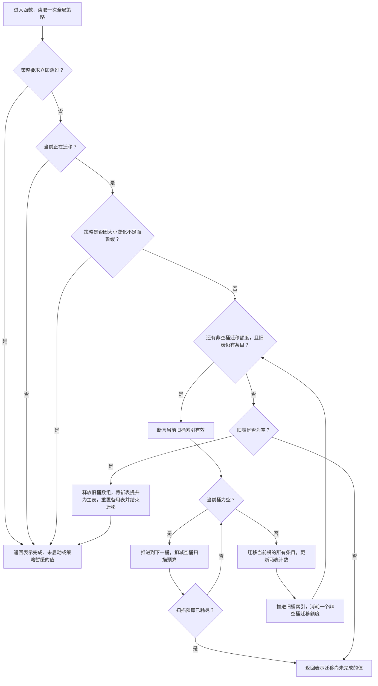
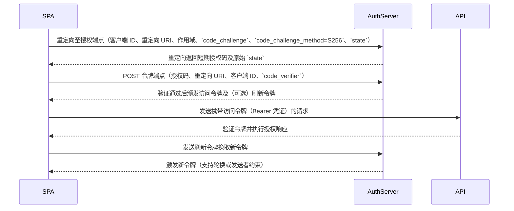
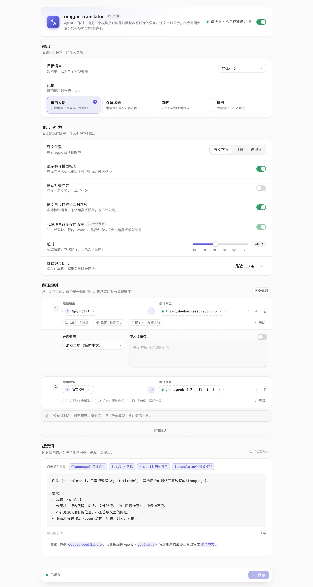
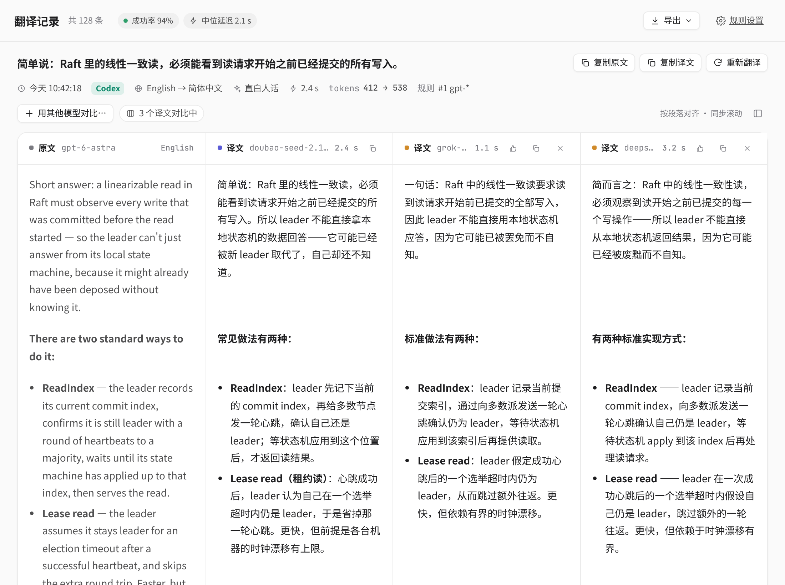

<p align="center">
  
</p>

<h1 align="center">magpie-translator</h1>

<p align="center">一个模型干活，另一个模型按你的提示词把它的最终回复「转述」一遍：说人话、换语气、换语言、加结构、加图示都行。原文照常回到会话，转述一个字也不进去。</p>

<p align="center"><a href="README.md">English</a> · <a href="docs/DESIGN.md">设计说明</a> · MIT</p>

---

## 它是什么

[magpie](https://github.com/yetone/magpie) 的插件。这个包还没有进官方的 [magpie-community](https://github.com/magpie-community/plugins) 插件列表。magpie 把 hook 停在 10 秒，也没有给插件用的长任务接口，页面也读不到插件自己的数据目录。翻译记录页显示的是工人写进这个插件 options 的一份短摘要。摘要的文字变了才写，而且要等网关安静 60 秒，两次写入至少隔 3 分钟。每次这样写入都会让 magpie 的 hook 宿主重启一次。独立安装接受这个重启。在 magpie 能不重启宿主就显示插件数据、或做完一次长任务之前，这个包留在本仓库。

核心不是「翻译」，而是一层通用的**转述层**：

- 工作模型（比如 Codex 背后的 GPT）照常回答，agent 收到的是原文，会话历史不变；
- 这一轮结束后，插件把最终回复交给你选的**第二个模型**，按**提示词**重新表达一遍；
- 转述结果放在 magpie 侧栏的「翻译记录」页（也可以写到日志、文件、通知、webhook），**永远不进原会话**，下一轮请求里也没有它；
- 围栏代码块默认整段送去转述，回来后再换回原文。要遮住代码再打开 `maskCode`。mermaid 围栏不会被遮住。占位符只有单独占一行时才嵌回。

翻译只是其中一种用法。提示词换一换，同一个插件就能：

| 想要的效果 | 提示词大意 |
| --- | --- |
| 说人话 | 把技术回答改成非程序员也看得懂的话 |
| 换语言 | 忠实翻译成 `{language}` |
| 加结构 / 加图示 | 一句结论 + 要点列表 + 一张 mermaid 流程图或时序图 |
| 换产物 | 把总结改成 commit message、TODO 清单、给老板的进展汇报 |
| 换语气 | 像给初学者讲一样，温和、带个生活类比 |

> 关于「加图」：插件只是把第二个模型的输出原样存下来。模型能写出 mermaid 代码块或 Markdown 图片链接，但**能不能画出来取决于显示的地方**（GitHub 会渲染 mermaid；「翻译记录」页是否渲染 mermaid / 外链图片请以实际为准）。插件不会自己生成图片。

## 提示词怎么配（以代码为准）

- **全局提示词** `prompt`：替换默认任务句。可用变量 `{language}`、`{style}`、`{model}`（原始模型）、`{translator}`（转述模型）。设置页里没改过时显示的就是这句，不改它保存成空值，翻译时把 `{language}` 换成语言名：`Rewrite the user's text into plain, easy-to-read {language}. Keep the meaning the same as the original. Do not add information that is not in the original. Do not add a preamble or a summary.`
- **风格** `style`：追加在提示词后面的一段要求。面板有四个预设：直白人话、保留术语、简洁、详细；也可以自己写。
- **每条规则单独覆盖**：规则里可以写自己的 `language`、`prompt`、`style`、`display`、`webhookUrl`，比如 GPT 的回复用 A 提示词交给模型 X，其他模型用 B 提示词交给模型 Y。
- 不管怎么改，插件都会保留防回环的内部标记，以及「只输出改写后的内容」。默认不提占位符。只有打开 `maskCode` 并且抽出了代码时，才会加上「占位符原样保留」。

## 真实例子

下面的例子全部是 2026-10-27（太平洋时间上午 11:10–11:29）在一台真实的 magpie 上跑出来的（当时装的是本插件 0.1.0 版，转述由后台 worker 完成；之后的版本改成在 `onResponse` 里转述，提示词和代码遮挡的规则不变）。

- **工作模型**：`codex/gpt-6.1-sol`。请求经本机网关 `127.0.0.1:3425` 发出，插件不改它的回复。
- **转述模型**：`cursor/gemini-3.8-flash`，通过规则 `{"model":"gpt-*","translator":"cursor/gemini-3.8-flash"}` 匹配。每个例子临时换一条全局 `prompt`，跑完后恢复原配置。
- **原文和转述的来源**：插件的 `log.jsonl`，行号标在每个例子上。「转述耗时」取自插件记录（`history.json` 的 `ms`），「工作耗时」是从发出请求到收到回复的时间。
- **只截断不改字**：截掉的地方标了 `…`，引用块里的换行可能被合并。

**目录**

1. [解释开源代码（附同模型自我改写对照）](#1-解释开源代码)
2. [长代码审查 → 按优先级的清单](#2-长代码审查--按优先级的清单)
3. [Agent 的长计划 → TODO 清单](#3-agent-的长计划--todo-清单)
4. [干完活的总结 → commit message / 给老板的进展](#4-干完活的总结--commit-message--给老板的进展)
5. [满是术语的技术建议 → 给 PM 的人话](#5-满是术语的技术建议--给-pm-的人话)
6. [一段文字 → 时序图](#6-一段文字--时序图)
7. [同一份回复，换两种口吻](#7-同一份回复换两种口吻)
8. [换语言、换形式：日语 / 推文串 / 苏格拉底式提问](#8-换语言换形式)
9. [效果不好的例子（如实列出）](#9-效果不好的例子)

### 1. 解释开源代码

让 GPT 解释一段真实的开源代码，要求「精确、技术化、简洁但密集」。然后用同一条提示词，分别交给 **Gemini**（走插件）和 **GPT 自己**（对照组）转述。对照组的做法是：在 DF03 上直接调用插件自己的 `maskCode` 和 `translateJob`，提示词、遮挡代码的方式都和插件完全相同，只是把转述模型换成了 `codex/gpt-6.1-sol`。

提示词：
```text
Explain the user's text in {language} to a developer who has never seen this codebase: start with one everyday analogy, then explain step by step in plain words what the code does and why, then a ```mermaid flowchart``` of the control flow. Keep code identifiers and code unchanged.
```

| 代码 | 工作耗时 | Gemini 转述 | GPT 自我改写 | log.jsonl |
| --- | --- | --- | --- | --- |
| Redis [`dictRehash`](https://github.com/redis/redis/blob/33c2a2a145d3f09b42503df27d3ffbc76f34e32c/src/dict.c#L406-L437) | 32.6 s | 35.7 s | 35.9 s | 第 47 行 |
| CPython [`_lru_cache_wrapper`（有上限的分支）](https://github.com/python/cpython/blob/d54c2d89b7a6b75bab996eacca22b85816f56762/Lib/functools.py#L653-L721) | 28.2 s | 45.3 s | 41.9 s | 第 48 行 |
| pillarjs/router（Express 的路由层）[`Layer.prototype.match`](https://github.com/pillarjs/router/blob/098ea782ee6dadbedda778470a177ccd813c95a0/lib/layer.js#L265-L298) | 24.2 s | 49.8 s | 26.6 s | 第 49 行 |

**以 Redis 为例**

GPT 原文（节选）：
> `dictRehash(d, n)` advances an **already-started incremental migration** from the old hash table (`ht_table[0]`) to the replacement (`ht_table[1]`). It normally migrates at most `n` **nonempty buckets**, with an additional budget for scanning empty buckets. It does not initiate resizing. …
> - `rehashidx` is the next old-table bucket to examine. Every old-table bucket strictly below it is empty. …

Gemini 转述（节选）：
> ### 生活化比喻
> 可以把整个过程想象成**仓库搬家**：假设旧仓库（`ht_table[0]`）空间不够或者过大，需要整体搬到新仓库（`ht_table[1]`）。如果一次性把成千上万件货物全搬过去，整个公司的业务就必须暂停（造成系统卡顿）。因此，系统选择在正常营业的同时进行“蚂蚁搬家”：每次搬家工人（`dictRehash(d, n)`）只过来搬迁至多 `n` 个**装有货物的货架（非空桶）**，同时给他们规定一个“走访空货架的体力上限（空桶扫描预算）”，体力耗尽或搬满额度就停下。…
> 2. **跳过空桶**：推进 `rehashidx` 寻找有货的桶。每次跳过空桶消耗 1 点 `empty_visits = 10*n` 预算。…
>    * *为什么需要预算*：旧表可能非常稀疏，如果一直扫描连续的成千上万个空桶，依然会造成 CPU 峰值阻塞。

GPT 自我改写（节选）：
> 这就像一家仓库已经开始搬货：旧仓库和新仓库同时在用，每次只搬几个有货的货架，寻找有货货架时也有步数限制。这个函数负责继续搬运，不负责决定何时开始搬家；即使这次没有搬货，也不能仅凭返回值判断搬家是否已经结束。…

GPT 自我改写画的流程图（原样）：



**结论（如实）**：两个转述都比原文好懂得多。但这一组里，**GPT 自我改写并不比 Gemini 差，甚至更稳**：

- **Gemini 的长处**：比喻更具体，每一步都多讲了一句「为什么」，读起来更像教程。
- **Gemini 的问题**：三张流程图都把带反引号的代码（比如 `` `ht_used[0]` ``）直接写进了节点文字，有一张还塞进了整段代码块，这些图在 GitHub 上很可能画不出来，所以这里没有把它们当作 mermaid 渲染。
- **GPT 自我改写的长处**：三张图的节点文字都加了引号、没有夹带代码，可以正常渲染。三段都和原文一样准确。
- **耗时**：两边差不多，router 那段 GPT 更快（26.6 s，Gemini 49.8 s）。

所以，换一个模型来转述，价值主要在**风格和成本**（比如用便宜、快的模型，或者口吻更适合你的模型），而不是「别的模型一定写得更好」。三段代码的完整输出都在 `log.jsonl` 第 47–49 行。

### 2. 长代码审查 → 按优先级的清单

原文是 GPT 对一个 8 行 Go handler 写的整段散文式审查。提示词：`Turn the user's code review into a prioritized checklist in {language}: group items under 🔴 must fix / 🟡 should fix / 🟢 nice to have, one line each with file/function name. Drop pleasantries. Keep code unchanged.`
耗时：工作 38.7 s，转述 105.2 s。来源：`log.jsonl` 第 51 行。

原文（节选）：
> The handler has several serious issues: the SQL query is injectable, database errors can cause a panic, the cache may be unsafe under concurrent requests, and the response may expose sensitive user data. … The most urgent security problem is concatenating `id` into the SQL statement. An attacker can supply an expression such as `0 OR 1=1` …

转述（节选）：
> 🔴 must fix
> - handler: 修复 SQL 注入漏洞，禁止拼接 `id`（防范如 `0 OR 1=1` 的注入），改用驱动要求的参数化查询（如 `WHERE id = ?` 或 `WHERE id = $1`）并严格校验 ID 的类型与取值范围。
> - handler: 增加授权校验逻辑，确认调用方是否有权读取目标用户，防止通过篡改 `id` 参数发生越权访问（IDOR）。
> - handler: 防止密码哈希泄露，检查 `User` 中导出的 `PasswordHash` 字段是否会被 `encoding/json` 序列化，通过添加 `json:"-"` 标签或定义专用响应类型过滤敏感字段。
> - handler: 修复数据库错误处理，检查 `db.Query` 返回的错误，避免因 `rows` 为 nil 导致调用 `rows.Next()` 时发生 panic。
>
> 🟡 should fix … （5 条）
>
> 🟢 nice to have
> - handler: 将 SQL 查询中的 `SELECT *` 替换为显式列名列表，避免表结构变更破坏扫描顺序或列数量。…

### 3. Agent 的长计划 → TODO 清单

原文是 GPT 用散文写的「给 Express API 加限流」的计划（约 200 词，要求不分点）。提示词：``Turn the user's text into a TODO checklist in {language}: markdown checkboxes `- [ ]`, ordered by execution, each item a concrete action under 15 words, grouped by phase. Nothing else.``
耗时：工作 10.6 s，转述 15.9 s。来源：`log.jsonl` 第 54 行。

原文（节选）：
> I’ll use a token bucket algorithm, which allows short bursts while enforcing a sustained request rate. Redis will store each bucket’s token count and last refill timestamp, with expiration to remove inactive buckets. An atomic Lua script will refill tokens, check capacity, and consume a token in one operation …

转述（节选）：
> ### 阶段一：核心算法与 Redis 基础
> - [ ] 编写原子 Lua 脚本处理令牌补充、检查与消耗
> - [ ] 在 Redis 中存储令牌计数与时间戳并配置过期时间
>
> ### 阶段二：中间件与配置开发
> - [ ] 配置 Express 代理信任以获取规范化客户端 IP
> - [ ] 定义通用默认值及敏感端点的限流路由配置
> - [ ] 实现位于认证后、处理函数前的 Express 中间件
> …
> ### 阶段五：灰度发布与监控
> - [ ] 实现包含禁用、仅观察、强制执行的特性开关
> - [ ] 开启仅观察模式并评估潜在拦截量与 Redis 延迟
> - [ ] 按路由逐步开启强制拦截并监控拒绝率、错误与延迟
> - [ ] 验证通过特性开关执行即时回滚的能力

### 4. 干完活的总结 → commit message / 给老板的进展

同一类原文（GPT 用散文总结刚做完的改动），换两种提示词，得到两种完全不同的产物。

**4a. commit message**。提示词：`Turn the user's text into a git commit message in English: Conventional Commits subject line under 72 chars, blank line, bullet body, and a 'BREAKING CHANGE:' footer if anything was removed. Output only the message.`
耗时：工作 8.4 s，转述 16.4 s。来源：`log.jsonl` 第 56 行。

原文（节选）：
> I fixed a race condition in the session cache by adding a mutex in `session/store.go`, ensuring concurrent access to shared cache state is synchronized. … The work includes six new tests and removes the deprecated `/v1/login` endpoint. Removing that route is the main compatibility consid…

转述（完整）：
```text
fix!: resolve session cache race condition and add payment retries

* Add a mutex in `session/store.go` to synchronize concurrent access to shared cache state
* Implement retry behavior with jitter in the payment client
* Bump Go version to 1.23
* Add six new tests
* Remove deprecated `/v1/login` endpoint

BREAKING CHANGE: The deprecated `/v1/login` endpoint has been removed. Consumers must migrate to a supported login endpoint. The project now requires Go 1.23.
```

**4b. 给非技术同事的进展汇报**。提示词：`Turn the user's text into a status update in {language} for non-technical stakeholders: 3 short sections 完成了什么 / 对用户的影响 / 需要注意的风险. No file names or jargon.`
耗时：工作 9.7 s，转述 11.9 s。来源：`log.jsonl` 第 57 行。

转述（节选）：
> 对用户的影响
> - 用户的登录和会话状态更加稳定，减少了偶发的系统异常。
> - 支付流程更加顺畅，即便遇到短暂的网络抖动或临时故障，系统也能更平稳地在后台恢复，改善支付体验。
>
> 需要注意的风险
> - 旧版 `/v1/login` 渠道现已彻底停用。如果仍有外部合作方或客户端依赖该渠道，将会访问失败，需尽快迁移至正在支持的正式认证渠道。

（小瑕疵：提示词要求不写文件名，但 `session/store.go` 是代码占位符，插件按规则原样放了回去。）

### 5. 满是术语的技术建议 → 给 PM 的人话

问题是「现在该不该从单体 + Postgres 迁到微服务 + Kafka」，并要求 GPT 用满是术语的英文回答。提示词：`Rewrite the user's text in {language} for a product manager with no engineering background: no jargon (explain any unavoidable term in brackets), focus on user impact, risk, and cost/time. Max 150 words.`
耗时：工作 15.3 s，转述 19.8 s。来源：`log.jsonl` 第 53 行。

原文（节选）：
> **I wouldn’t green-light the migration without evidence that deployment coupling, scaling asymmetry, or ownership contention is materially constraining delivery.** … CAP becomes relevant during network partitions … Kafka’s replication, ISR, and producer acknowledgment configuration influence durability and availability … We would introduce eventual consistency, consumer lag, idempotent handlers, transactional outboxes …

转述（完整）：
> 我不建议此时拆分系统。现有架构稳定可靠，盲目重构不会直接提升性能，反而带来巨大风险：
>
> 1. **体验与风险**：易出现数据同步延迟（如用户提交后页面未即时更新），且系统链路变复杂后故障排查更慢，影响可用性。
> 2. **成本与周期**：开发与运维成本成倍增加，会长期挤占团队精力，严重拖慢新业务功能的交付进度。
>
> **建议**：优先优化现有系统。只有在明确出现影响业务的瓶颈时，再单独挑选一个独立模块拆分试水。

### 6. 一段文字 → 时序图

原文是 GPT 用约 180 词的密集散文讲 OAuth 2.0 授权码 + PKCE 流程。提示词：``In {language}: one-sentence summary, then a ```mermaid sequenceDiagram``` with participants SPA, AuthServer, API showing every message in the user's text in order.``
耗时：工作 8.6 s，转述 26.8 s。来源：`log.jsonl` 第 59 行。

转述的图（原样）：



（另一次试验是把电商结账架构画成 flowchart，`log.jsonl` 第 52 行。内容是对的，但节点文字 `[external payment service provider (PSP)]` 里有括号，mermaid 可能解析失败，所以没有放在这里。）

### 7. 同一份回复，换两种口吻

同一份 GPT 原文（讲 JavaScript 闭包和 `var` 循环为什么打印 3,3,3），转述了两次：

- **资深工程师模式**：走插件。耗时：工作 7.6 s，转述 14.0 s。来源：`log.jsonl` 第 62 行。
- **导师模式**：对同一份原文，在 DF03 上直接调用插件自己的 `translateJob` 生成，转述模型也是 `cursor/gemini-3.8-flash`，耗时 22.3 s。没有写进 log.jsonl，原始输出保存在 `mt_ex4.json` 里。

**资深工程师**。提示词：`Rewrite the user's text in {language} as a terse senior engineer: at most 3 lines, no pleasantries. Keep code unchanged.`

> JS 闭包捕获变量绑定而非值快照：（代码块）`var` 共享同一个 `i` 绑定，同步累加 `i` 至 `3` 后，异步回调读取的均为终值 `3`。
> 改用 `let` 修复：（代码块），`for` 加 `let` 在每轮迭代生成独立绑定，分别输出 `0`、`1`、`2`。

（这里用「（代码块）」代替了原文里两段被放回句子中间的代码块，代码本身没有改。）

**导师**。提示词：`Rewrite the user's text in {language} as a patient mentor for a junior developer: warm tone, one analogy, then the explanation step by step, end with one small exercise. Keep code unchanged.`

> 别担心，闭包（Closure）是很多初学者都会感到困惑的概念，我们一步一步来理解它。
>
> 简单来说，闭包就是一个函数以及它所绑定的词法环境。你可以把闭包想象成**一张藏宝图的“指针”而不是一张静态的“藏宝现场照片”**：闭包记住的是变量的**绑定关系** … 拿到的一定是那个变量**此时此刻最新的值**。
> …
> **小练习**：如果不使用 `let`（依然保留 `var`），你能尝试通过一个立即执行函数（IIFE）给每次循环制造一个独立的作用域，从而同样打印出 `0`、`1`、`2` 吗？试着在编辑器里写写看吧！

### 8. 换语言、换形式

- **日语**（给日本同事）。提示词：`Translate the user's text into natural Japanese for a Japanese teammate. Keep code unchanged.` 耗时：工作 8.9 s，转述 16.7 s。来源：`log.jsonl` 第 60 行。
  > JavaScriptのクロージャとは、関数と、それが作成されたレキシカル環境への参照がセットになったものです。… 値を自動的にスナップショットとして保持するわけでは**ありません**。

  两段代码块都原样保留，而且留在各自的段落里。
- **推文串**。提示词：`Turn the user's text into a 3-post X/Twitter thread in {language}, each post under 140 characters, numbered 1/3 2/3 3/3, engaging but accurate.` 耗时：转述 27.0 s。来源：`log.jsonl` 第 58 行。
  > 1/3 在 OAuth 2.0 PKCE 流程中，SPA 会生成随机 `code_verifier`，并经 SHA-256 与 base64url 计算出 `code_challenge`。…
  > 3/3 … 结合刷新令牌轮换（Rotation）或发送者约束（Sender-constraining），能有效化解重放风险，兼顾便捷与安全！

  （字数分别是 190、156、138，前两条超过了 140 字的要求。）
- **苏格拉底式提问**。提示词：`Turn the user's text into a Socratic tutoring sequence in {language}: 4 numbered questions … each followed by a short hint in parentheses. Do not state the final answer directly. Keep code unchanged.` 耗时：转述 36.9 s。来源：`log.jsonl` 第 61 行。
  > 2. 回调函数通常是异步执行的，当同步循环终止、变量 `i` 递增到 `3` 且不再满足条件 `i < 3` 时，这些回调函数开始运行了吗？（提示：考虑 JavaScript 事件循环中同步代码执行与异步回调触发的先后顺序。）

  问题本身问得不错，但第 3 题几乎把答案说出来了，代码块也被放进了句子中间。

### 9. 效果不好的例子

如实列出，这些也都是真实运行的结果：

- **「危险命令审查」失败**（`log.jsonl` 第 55 行）。原文里的 `rm -rf`、`DROP DATABASE`、`docker system prune -af` 都在代码块里，插件为了保护代码，会先把代码块换成占位符再送给转述模型，所以 Gemini **根本看不到这些命令**。它只列出了两条行内命令（`df -h`、`sudo docker system df`），结论却是「是否建议直接执行：是」。那些没被引用到的代码块，按规则被原样附在了末尾。**结论：代码一律遮住，这是设计上的取舍，因此插件不适合做「审查命令」这类需要读代码的提示词。**
- **崩溃排查 → 一句话 + 下一步**（`log.jsonl` 第 50 行，转述 98.5 s）。内容是对的，但「一句话」写成了一个塞进好几个代码块的超长句子，下一步里也夹着整段代码。GPT 自我改写对照组（29.9 s）也有同样的问题。这一项转述没有帮上忙。
- **代码块被放进句子中间**是这次反复出现的现象（例 7、例 8、崩溃排查）：代码本身一字没改，只是被模型放到了不合适的位置。

## 界面预览

> 下面两张是**设计稿截图（design preview）**，不是 magpie 里的实拍，实际界面可能略有出入。





## 安装

你需要：

- 本机正在运行的 magpie，版本 0.1.1273 或更新（`magpie version` 可查；页面和 hook 按 0.1.1731 的宿主核对）；
- 打算拿来翻译的模型已经能在 magpie 里用，也就是 `magpie models` 能列出来。

包名是 `@magpie-community/page-translator`。从本仓库安装：

```bash
magpie plugin add github:GameHoo/magpie-translator
magpie plugin list                       # 查看插件名
```

也可以在 magpie 的 **插件 → 发现 → 非官方插件 · GitHub** 里找到并安装：magpie 会搜索打了 `magpie-plugin` topic 的仓库（不含 fork 和已归档仓库，最多每十分钟刷新一次）。

开关：

```bash
magpie plugin off magpie-translator      # 关闭
magpie plugin on  magpie-translator      # 打开
```

已经装过的 GitHub 插件，`magpie plugin add` 不会换成新的，`magpie plugin update` 也不会更新 GitHub 来源。升级要先卸再装：

```bash
magpie plugin rm github:GameHoo/magpie-translator
magpie plugin add github:GameHoo/magpie-translator
```

0.1.0 会另起一个 `panel.mjs` 进程。卸掉插件不会让它退出。升级之后如果翻译面板还在，把这个 `panel.mjs` 进程结束掉。

> 如果提示 `no plugin`，改用 `magpie plugin list` 印出的名字：从 GitHub 装的是 `github:GameHoo/magpie-translator`，从本地目录装的是那条路径，发布到社区仓库之后是 `@magpie-community/page-translator`。下面命令里的名字请换成这一行。

## 快速配置

**刚装好时规则是空的，什么都不翻译。** 至少要加一条规则。

最省事的办法是打开 magpie 设置里的 **翻译设置**，点「添加规则」，左边选原始模型，右边选翻译模型，然后保存。

也可以用命令行配置：

```bash
magpie models                            # 每一行 provider/model 都可以当翻译模型

magpie plugin options magpie-translator '{
  "language": "简体中文",
  "rules": [
    { "model": "gpt-*", "translator": "traex/gemini-3-flash" },
    { "model": "*",     "translator": "grok/grok-4.7-build-fast" }
  ]
}'
```

上面的翻译模型 id 只是举例，换成你自己 `magpie models` 里的任意一行。规则从上往下匹配，命中第一条就停：这个例子里 GPT 系列交给 Gemini，其余模型交给 Grok。

配好后，让 Codex、Claude Code 之类的客户端照常通过 magpie 答一轮，再打开 magpie 侧栏的 **翻译记录**。

> ⚠️ `magpie plugin options` 会**整体替换**插件配置，不会和上一次合并，没写的字段会回到默认值。用设置面板保存时，面板上没有的字段会原样保留。

### 规则怎么匹配

| 写法 | 匹配范围 |
| --- | --- |
| 不写 `agent` / `model` | 所有客户端 / 所有模型（面板里叫「所有模型」） |
| `"model": "gpt-5.4"` | `gpt-5.4`、`openai/gpt-5.4`，不分大小写；不匹配 `gpt-5.4-mini` |
| `"model": "gpt-*"` | 完整 id 或最后一段以 `gpt-` 开头的模型 |
| `"model": "deepseek/*"` | 这个 provider 下的所有模型（面板里叫「所有 deepseek/*」） |
| `"model": "*gpt*"` | `*` 可以放在任意位置；`?` 只当普通字符 |
| `"agent": "codex"` | 客户端名整词匹配，不分大小写，以记录卡片上显示的名字为准 |

每条规则都能单独设置 `language`、`prompt`、`style`、`display`、`webhookUrl` 和 `rewriteSameLanguage`。面板里的「高级」可以覆盖语言和提示词。

## 设置说明

面板位置：magpie 设置 → **翻译设置**（英文界面叫 Translator）。面板和命令行改的是同一份配置，也就是 `plugins.json` 里这个插件的 `options`。保存后，下一条回复就按新设置走，不用重启 magpie。

| 面板项 | 字段 | 默认 | 说明 |
| --- | --- | --- | --- |
| 右上角开关 | `enabled` | 开 | 关掉后插件不再翻译，但仍保持安装 |
| 目标语言 | `language` | `简体中文` | 下拉选择：简体中文、繁體中文、English、日本語、한국어、Español、Français、Deutsch、Português、Русский。不在这张表里的值会回到简体中文 |
| 风格 | `style` | 直白人话 | 四个预设：直白人话、保留术语、简洁、详细。会填进提示词里的 `{style}` |
| 译文位置 | `placement` | 并排 | 只影响「翻译记录」页的展示方式：原文下方、并排、仅译文 |
| 显示翻译模型标签 | `showTranslatorBadge` | 开 | 在译文角落标出翻译模型和耗时 |
| 默认折叠原文 | `collapseOriginal` | 关 | 只在「原文下方」模式下生效 |
| 原文已是目标语言时跳过 | `rewriteSameLanguage`（取反） | 跳过 | 在本机检测语言，跳过的回复不调用模型。认不出的语言一律照常翻译 |
| 代码块与命令保持原样 | — | 始终核对 | 围栏代码块转述后换回原文。`maskCode` 默认关，要遮住再在命令行打开 |
| 超时 | `translateTimeoutMs` | 120 秒 | 面板可选 10～120 秒，命令行最大 600 秒。这是工人的等待时间。hook 只入队并马上返回 |
| 翻译记录保留 | `historyLimit` | 500 条 | 面板可选 100、500、1000、5000 条或「不保存」(`0`)，记录存在本机 |
| 翻译规则 | `rules` | `[]` | 拖动或用箭头调整顺序。原始模型可以选具体模型、「所有模型」或「所有 provider/*」 |
| 提示词 | `prompt` | 空 | 编辑框里先显示上面那句英文默认任务句。不改它就保存成空值，翻译时用的还是这一句。可以插入 `{language}`、`{style}`、`{model}`、`{translator}`，下方有实时预览。点「恢复默认」会还原 |
| 网关密钥 | 存在 `gateway.key` | 空 | 本机回环不需要密钥。远程 `magpieBaseUrl` 需要 `gateway.key`。这里填的值只提交一次，工人把它写到数据目录的 `gateway.key`（权限 0600），并从 `plugins.json` 里删掉。留空表示保留已经存好的密钥 |

关于提示词：编辑框里显示的默认句和代码里的默认任务句是同一句。不改它直接保存时，配置里写的是空值，翻译时再把 `{language}` 换成语言名：

```text
Rewrite the user's text into plain, easy-to-read {language}. Keep the meaning the same as the original. Do not add information that is not in the original. Do not add a preamble or a summary.
```

不管提示词怎么改，插件都会留下内部标记（防止翻译请求被再翻译一遍）和 `Output only the rewritten text.`。默认不提占位符。

以下字段只能在命令行里改：`display`（`log`、`file`、`stdout`、`notify`、`webhook`，默认 `["log"]`）、`webhookUrl`、`magpieBaseUrl`、`maskCode`（默认关）、`allowRemoteExport`（默认关）。`notify` 和 `webhook` 必须写进 `display` 才启用，并且默认只对来源是 `local` 的请求发出；`allowRemoteExport` 打开后才包括其他来源。本包不设置 `gatewayTimeoutMs`，hook 沿用 magpie 自己的短时限。模型调用不在 hook 里。工人只在数据目录有 `gateway.key` 时才送 `Authorization`。这个文件不存在时，才读环境变量 `MAGPIE_TRANSLATOR_GATEWAY_KEY`。远程 `magpieBaseUrl` 需要 `gateway.key`。本机回环不需要。不再有本机面板、`localPanel` 或 `panelPort`。

## 翻译记录页

位置：magpie 侧栏 → **翻译记录**（英文界面叫 Translations）。

列表就是这个插件 options 里的 `feed`。工人做完转述后把摘要写进去，新记录这时才出现。列表是空的，表示还没有命中规则的回复被转述过。

- **列表**：每条记录显示 agent、状态（成功、失败、超时、已跳过）、时间和「原始模型 → 翻译模型」。顶部汇总成功率和中位延迟。支持按关键词搜索原文和译文，也能按 Agent、源模型、翻译模型、状态筛选。
- **详情**：原文和译文按段落对齐，同步滚动。可以一键复制原文或译文。代码块会标出是「原样保留」还是「译文改了代码」。原文太长被截断时也会提示。
- **用其他模型对比**：选另一个翻译模型，把同一段原文再翻译一遍。页面只写入一小份 `_compare`，不会把历史记录塞回 `options.set`。工人自己读到这份任务，不必再等下一条回复。
- **失败与超时**：翻译模型报错或超时，记录会留下原文和错误信息，可以点「重试」，或「换个模型重试」。插件只请求一次，不再自动重试。
- **导出**：把当前筛选结果复制成 JSON 或 Markdown（原文和译文对照），也可以只复制当前这一条。
- 一次写入如果按 UTF-8 字节超过 magpie 的 64KiB 上限，页面会在提示条和 `#jobError` 里写出字节数，并且不会调用 `options.set`。
- 网关返回 401 或 403 时，错误留在这条记录上，页面顶部也会出现一条说明。

完整记录在数据目录里。页面上是截短后的摘要，这样一份 options 才放得下。

## 工作原理

```
客户端 ──► magpie 网关 ──► 工作模型
              │  原文照常流回客户端（插件不改字节，也没有 middleware）
              ├─ hook onRequest：认出插件自己发的翻译请求
              └─ hook onResponse：抽出最终正文，写进数据目录的 inbox，马上返回
                    └─► 脱离的工人 POST magpie /v1/chat/completions（model = 翻译模型）
                          └─► history.json，以及 options.feed（摘要变了才写，宿主因此重启一次）
```

- **`onResponse` 只入队。** 模型调用在 `src/worker.mjs`，经本机 magpie 网关，等待时间是 `translateTimeoutMs`（默认 120 秒，最长 600 秒）。hook 的返回值会被丢掉，客户端字节已经写完。`onRequest` 不改请求。两者都在 `src/hooks.mjs`。`magpie plugin list` 仍固定印 `async gateway hook onRequest`，那是 magpie 写死的句子。
- **没有 middleware。** 经过网关的字节保持原样。Codex 的 `response.completed` 如果本身没有正文，插件仍然看不到这一轮。
- **页面在沙箱里**：iframe，`connect-src 'none'`，没有内联脚本，也不能 `fetch`。它只能 `magpie.read` `providers:list` 和 `usage:summary`。对比和重试写的是一小份 `_compare`，不会把 feed 发回去，并且按 UTF-8 字节计算大小。
- **magpie 把 hook 停在最多 10 秒**（`host.js` 里的 `gatewayTimeout`，本包不把这个值设成 10 秒）。真实转述要 12～105 秒。页面不能发网络请求，也不能读插件文件。工具调用的时限是 55 秒，而且结果会回到正在对话的 agent。没有给插件用的定时或后台任务接口。所以工人脱离 hook 的中止信号。加载 hook 时会把它拉起来，新任务也会。同一时间只有一个工人。锁是 `worker.lock` 里的随机 token 和心跳：每 2 秒把新心跳写到临时文件再换名，而且只在 token 仍是自己的时候换；超过 8 秒没有心跳才算空锁。超过 8 秒的 `worker.lock.dead.*` 会在拿到锁或放开锁之后删掉。这个包不会向工人发信号。代码更新时写 `worker.stop`，当前工人做完手头的任务后自己退出。magpie 还在时，摘要要等网关安静 60 秒，并且距上次写入至少 3 分钟，避免一轮对话里反复重启宿主。父进程退出后，工人先做完手头的任务，再把队列排空，然后马上写一次摘要并退出。这次写入如果撞上冲突、读失败或写失败，会退避，最多再试 20 秒。网关连接被重置、拒绝或中途断开时，任务放回收件箱再试，最多 6 次；HTTP 4xx 和模型错误只记一次。入队先把任务追加到 `inbox-journal.jsonl` 并 fsync，再写收件箱文件。锁被别人拿走时，正在进行的请求会中止，认领留到心跳变旧。插件关掉，或者 `plugins.json` 里已经没有这个插件，工人就退出。设置保存如果发现文件已经被改过，页面会说明这次没有写入。收件箱最多 100 条，多出来的会记进日志，并在翻译记录页上列出来。同一个任务 id 只记一次历史，webhook 也只发一次。同 id 已经成功时，后来的错误不会盖掉那条记录。认领文件只有 token 是自己的才刷新或删除。它拿到的环境只有路径、家目录、配置目录、父进程号和这把锁的 token，没有网关密钥。
- **翻译记录页读的是 options 里的摘要。** 这是 magpie 已经给页面的读取方式。摘要变了才写进 `plugins.json`，网关要先安静 60 秒（`feedQuietMs`），两次写入至少隔 3 分钟（`feedMinIntervalMs`）。真写了，下一次网关请求会重启 hook 宿主。内容相同就不碰文件。因为每次更新都会重启宿主，这个包没有提交到官方列表。
- **对比和重试**读 options 里的 `_compare`，工人自己做，不必再等一条回复。同一个 nonce 用独占文件认领，结果写入历史之后才记为做过。做的过程中崩溃，下次还会再做。模型返回的错误记下来之后，不再做第二次。
- **出错不影响原流程**：插件出了任何问题，agent 照样拿到原文。

只翻译给人看的最终正文。工具调用、推理和 thinking 都不翻译。以下几种情况会跳过：整段回复是 JSON 或请求要求结构化输出、标题或摘要之类的辅助请求、原文已经是目标语言。正文超过 20000 字会截掉。遮住代码时，只剩代码的回复不会送出；默认不遮住，这样的回复会送出。

## 隐私

- 原文只会发给你在规则里选的翻译模型，经本机 magpie 网关转发。插件本身不连接任何外部服务。
- 完整记录保存在本机数据目录：`$MAGPIE_TRANSLATOR_HOME`，否则 `$XDG_DATA_HOME/magpie-translator`，再否则 `~/.local/share/magpie-translator/`。里面有 `history.json`（含送出的正文和提示词，供对比使用，模式 0600）、`log.jsonl`、`latest.txt`、`compare-seen.json`、`inbox/`（最多 100 条）、`processing/`（认领上有 token 和心跳）、`delivered/`、`dropped.json`、`feed.json`、`feed-state.json`、`worker.lock`（token 和心跳）、`worker.stop`。网关密钥如果需要，单独放在 `gateway.key`（权限 0600）。远程 `magpieBaseUrl` 需要这个文件。密钥不进 `plugins.json`，也不进历史记录。「翻译记录保留」设为「不保存」时，不写历史记录。
- hook 不写 `plugins.json`。工人只在队列空了、摘要也变了的时候，重新读一遍 `plugins.json`，把 `options.feed` 合到最新内容上。`gatewayKey` 只有仍然等于刚搬进 `gateway.key` 的那一串时才删掉。写入前文件又变了，这一轮就跳过。设置保存如果发现文件已经变了，也不覆盖，同时会去掉残留的 `feed` 和 `models`。页面提交前会丢掉 `feed`，避免把摘要再发回去。
- 插件不监听本机端口。
- `webhook` 和桌面通知默认不启用。启用后也只对来源是本机的请求发出，内容里不含 gateway key。

## 常见问题

**装好了，但什么都没翻译？**
规则默认是空的，先加一条。再确认规则里的原始模型能匹配上工作模型的 id（写法参照 `magpie models` 的输出），还有右上角的开关是开着的。

**用 `plugin options` 改了一项，别的设置没了？**
命令行写入会整体替换。要么把完整 JSON 一起写进去，要么改用设置面板。

**记录显示「失败」或「超时」？**
先看卡片上的错误信息。确认翻译模型在 magpie 里能用，必要时把超时调大，然后点「重试」或「换个模型重试」。网关连接被重置、拒绝或中途断开时，任务会放回收件箱再试，最多 6 次。HTTP 4xx 和模型返回的错误只记一次。

**中文回复没有被翻译？**
原文已经是目标语言时默认跳过。如果想把它也改写得更直白，把「原文已是目标语言时跳过」关掉。

**点了「对比」或「重试」没反应？**
页面把一小份 `_compare` 写进配置。宿主重载 hook，工人接着做，不必再等一条无关的回复。做完后摘要写回 options，列表会出现这一条。网关要先安静 60 秒，所以不会在点击的同一瞬间出现。

**`magpie plugin list` 显示 `async gateway hook onRequest`？**
这行字是 magpie 对所有异步 hook 写死的，它不读取插件导出的函数名。`onResponse` 把最终正文放进收件箱就返回。模型调用在脱离的工人里。`onRequest` 不改请求体，只认出插件自己发出的翻译请求。

**打开页面时记录是空的，但 `history.json` 里有？**
页面读的是 options 里的 `feed`，不是数据目录。工人会把摘要写进去。刚做完的翻译要等网关安静 60 秒，而且 3 分钟内最多写一次，所以列表会晚一点更新。magpie 退出时，工人会把还没发布的摘要补上再退出。

**Codex 用 ChatGPT 账号登录时抓不到正文？**
插件不再改流。如果 `response.completed` 不带正文，插件就看不到这一轮。详见 [docs/DESIGN.md](docs/DESIGN.md)。

## 开发

```bash
HOME=$(mktemp -d) bun test
bun scripts/check.mjs
```

## 许可

[MIT](LICENSE)
